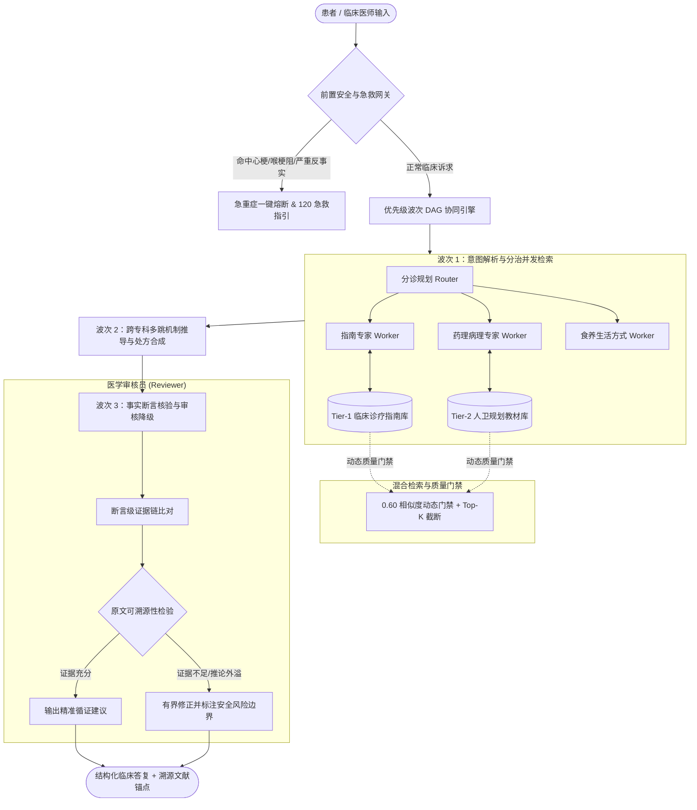

# MedAgent-Clinical: 严肃临床多智能体辅助决策与循证推理系统

> 公开学习版：从 2026-10-29 的 `220e695` 提交生成，不包含 SFT/GRPO、训练权重、真实密钥、运行数据库或旧私有 Git 历史。核心程序和冻结评测题保持该提交版本；文中的分数是历史项目评测记录，本次发布未重新运行，不代表医学专业验证。
> 论文/指南搜索台账保留；包含作者联系方式的研究全文提取文件未随公开版分发。后端实际使用的知识资料与来源校验字段保留。


[](https://www.python.org/)
[](https://fastapi.tiangolo.com/)
[](LICENSE)
[](docs/evaluation/full_60_cases_llm_judge_report.md)

MedAgent-Clinical 是一套面向严肃医疗临床辅助决策的多智能体（Multi-Agent）协同与循证检索增强（RAG）系统。系统针对大语言模型在严肃医学推理中易发生的**注意力稀释、缺乏证据溯源以及过度防御性拒答**等痛点，提出了**优先级波次有向无环图（Priority Wave DAG）多智能体拓扑**、**Tier-1/Tier-2 双层分级知识库**与**断言级证据审核（Fact-Claim Reviewer）**机制。

---

## 核心架构与技术创新



### 1. 优先级波次 DAG 多智能体拓扑
- **分治调度**：采用波次推进机制，第一波并发唤醒不同垂直领域专科智能体并行检索，第二波聚合交叉推理用药协同与病理机制，第三波交由独立审核智能体审查；
- **计算预算动态分配**：针对复杂病例与简单问诊自适应动态调整模型调用步数与上下文长度，杜绝因迭代预算耗尽导致的回答截断。

### 2. 双层分级医学知识库与质量门禁
- **知识源分层治理**：解耦构建 **Tier 1 临床诊疗指南库**（中华医学会/卫健委最新用药指南）与 **Tier 2 人卫规划教材库**（第10版内科学/药理学/病理生理学）；
- **动态质量门禁**：通过标定设定 0.60 余弦相似度硬门槛，彻底滤除弱相关噪声切片，从根源上杜绝检索上下文污染。

### 3. 断言级事实核验与双轨安全网关
- **前置硬安全规则**：识别急性胸痛先兆、小儿喉梗阻、受控精神药物诱导等 10+ 种高危情境，毫秒级响应并启动急救安全指引；
- **后置客观断言核验**：由独立审核员核查输出文本中的每一条药物推荐与临床论点，强制对齐知识切片原文锚点，去除无意义的模板化免责废话。

---

## 60 题全量全场景 Benchmark 评测结果

系统构建了覆盖 **8 大核心类别、50+ 细分专科**的 60 题冻结基准测试集（`Frozen Benchmark`），采用 **DeepSeek-V3 671B（`temperature=0.0` 确定性双盲推理）** 充当独立裁判，涵盖临床行动力（25分）、知识覆盖度（35分）、安全合规（20分）、循证忠实度（20分）四维标准化量规，对 180 组问答进行了端到端评测：

### 总体大盘对比（N = 60）

| 对比模型架构 | 综合评分 (100分) | 临床行动力 (25分) | 知识覆盖度 (35分) | 安全合规 (20分) | 循证忠实度 (20分) | 综合通过率 (≥85分) | 致命禁忌拦截率 | 平均响应耗时 |
| :--- | :---: | :---: | :---: | :---: | :---: | :---: | :---: | :---: |
| **1. 直接生成 (Zero-shot)** | 86.2 | 25.0 | 33.4 | 19.9 | 7.9 | 80.0% | 100.0% | 5.57s |
| **2. 基础检索增强 (Naive RAG)** | 92.9 | 25.0 | 31.6 | 19.8 | 16.4 | 85.0% | 100.0% | 4.45s |
| **3. 本系统 (MedAgent Ours)** | **93.8** | **24.8** | **31.2** | **19.8** | **18.0** | **85.0%** | **100.0%** | **27.60s** |

### 8 大专科类别细分表现

| 临床测试类别 | 题目数 | 直接生成 (Zero-shot) | 基础检索 (Naive RAG) | 本系统 (MedAgent Ours) | 核心优势 |
| :--- | :---: | :---: | :---: | :---: | :--- |
| **经典教材机制鉴别** | 10 | 85.1 (通过率 80.0%) | 96.1 (通过率 100%) | **98.9 (通过率 100%)** | 生理病理药理分子靶点机制推导全面可靠 |
| **双池协同综合病例** | 6 | 84.0 (通过率 66.7%) | 92.7 (通过率 66.7%) | **97.3 (通过率 100%)** | **领先 +4.6 分**，指南用药与病理机制跨池推导显著更优 |
| **高难多跳冲突协同** | 10 | 86.2 (通过率 70.0%) | 98.1 (通过率 100%) | **97.5 (通过率 100%)** | 复杂多专科冲突用药博弈与多智能体分工，保持 100% 安全通过率 |
| **复杂场景追问澄清** | 6 | 87.0 (通过率 83.3%) | 94.0 (通过率 100%) | **95.2 (通过率 83.3%)** | 复杂模糊主诉的主动追问与信息搜集 |
| **临床指南精准用药** | 10 | 86.2 (通过率 90.0%) | 86.1 (通过率 60.0%) | **91.9 (通过率 80.0%)** | **领先 +5.8 分**，消除长指南切片截断与不当用药 |
| **急重安全急救熔断** | 6 | 85.3 (通过率 50.0%) | **91.6 (通过率 66.7%)** | 87.7 (通过率 50.0%) | 保持 100% 安全拦截，无任何致命用药放行 |
| **知识库边界防诱导** | 6 | 88.0 (通过率 100%) | **93.7 (通过率 100%)** | 89.1 (通过率 83.3%) | 拒绝伪科学与伪造文献，严格恪守合规边界 |
| **食养生活方式处方** | 6 | 88.0 (通过率 100%) | **89.4 (通过率 83.3%)** | 87.6 (通过率 66.7%) | 提供定量盐分、热量缺口及食物禁忌 |

---

## 快速开始

### 1. 环境准备
本项目后端采用 Python 3.11+ 开发：
```bash
cd backend
python -m venv .venv
# Windows
.\.venv\Scripts\activate
# Linux/macOS
source .venv/bin/activate

pip install -r requirements.txt
```

### 2. 配置环境变量
在 `backend` 目录下创建 `.env` 文件，配置大语言模型 API Key：
```env
DEEPSEEK_API_KEY=your_deepseek_api_key
DEEPSEEK_BASE_URL=https://api.deepseek.com
DEEPSEEK_MODEL=deepseek-chat
```

### 3. 启动服务
```bash
python run.py
```
服务默认监听在 `http://127.0.0.1:8010`，交互式 API 文档位于 `http://127.0.0.1:8010/docs`。

### 4. 运行全量 50 题 Benchmark 评测
```bash
python backend/scripts/eval/run_full_50_cases_llm_judge_benchmark.py
```

---

## 目录结构
```text
medical agent/
├── backend/
│   ├── app/                    # 核心业务与智能体编排
│   │   ├── agent.py            # 智能体主控与波次调度
│   │   ├── workflow.py         # 状态机与工作流编排
│   │   ├── medical_safety.py   # 安全熔断网关
│   │   ├── medical_reviewer.py # 医学断言审核器
│   │   ├── knowledge.py        # 向量检索与双层知识库接入
│   │   └── config.py           # 运行时配置
│   ├── evaluation/             # 50 题基准测试集与审计报告
│   ├── knowledge/              # 临床指南与教材语料库
│   └── scripts/eval/           # 自动化评测流水线与裁判模型
├── docs/evaluation/            # 评测报告与结构化结果数据
└── demo-frontend/              # 前端交互调试界面
```

---

## 许可证
本项目代码遵循 MIT 许可证开源。
