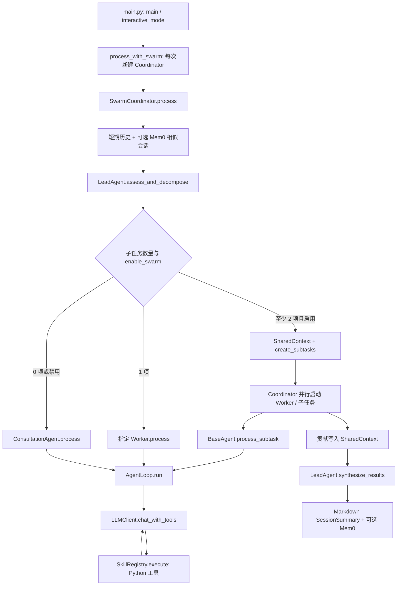

# 阶段 A：MediX 参考项目静态审查

审查日期：2026-10-13（Asia/Shanghai）。范围：第三方参考源码的设计理解与工程核对；本轮仅阶段 A、B。

## 1. 结论与证据边界

该项目实现了“LLM 分解任务 → 按子任务数量路由 → Worker 的工具调用循环 → 并行结果汇总”的教学框架。适合学习 Agent Loop、Function Calling 和异步任务协作；当前源码不足以证明它具有可靠的业务写入控制、完整混合检索或可恢复的工作流。

本报告采用四种标签：

- **参考资料宣称**：README、注释、SKILL.md 或示例文字声称的能力，未经运行证实。
- **源码可证明**：静态阅读能够确定存在的代码结构、分支或占位行为；不表示安装成功、运行成功或语义正确。
- **本地已验证**：本次仅核对目录、文件存在性、文本位置和源文件指纹；功能测试为 `not_run`。
- **尚未实现/未接入**：审查范围内只有占位、声明，或没有主运行链路的调用证据。

### 材料、来源和许可证

| 项目 | 本次观察 | 影响 |
|---|---|---|
| 工作区 | `E:/medical agent` | 交付文档在独立 `docs/`，不改参考代码 |
| 已存在内容 | `medix-agent-swarm/`、`MediX-R1/`、两个 MP4、顶层 `config.py` | 直接审查已有解压目录，无法证明其与原 ZIP 一致 |
| 用户所述 PDF、ZIP | 首次审查时工作区内均未找到；用户后续提供 `D:/edge_download/居丽叶的简历项目7：医疗助手Agent.pdf`（43 页），已读取并查看第 9 页 | PDF 已可参考；指标核验仍为 `not_run`，原 ZIP 仍未提供，未解压新材料 |
| Git | 工作区和 `medix-agent-swarm` 均无法解析 Git 仓库/HEAD | 无可引用 commit SHA；不做 commit/push |
| 项目指令 | 工作区内及检查的上级路径未发现 `AGENTS.md` | 本次以用户粘贴要求为范围依据 |
| 许可证 | `medix-agent-swarm/README.md:702` 声称 MIT；未发现独立 LICENSE/COPYING/NOTICE 文件 | 这是许可证声明，授权范围与权利人来源仍待确认 |
| 原始来源 | `medix-agent-swarm/setup.py:19`、`README.md:708` 的 GitHub 地址为占位 | 无法追溯当前源码的官方版本和修改历史 |
| MediX-R1 来源线索 | `MediX-R1/eval/eval.sh:20` 引用 `MBZUAI/MediX-R1-8B`；`training/setup.py:50` 声称 Apache 2.0，URL 指向 verl | 只说明文件中的来源线索，不能将子组件声明扩展为整个资料包授权 |

上述许可证检查不是法律意见。本轮不复制参考源码建立公开项目；后续公开前需补齐原始仓库、完整许可证及来源/改动记录。

没有读取顶层 `config.py`、`.env`、`.claude/settings.local.json` 的内容；查看源文件时省略凭据相关赋值行。没有读取 Milvus 数据库内容、视频、模型权重、大型评测结果或已有会话记录。没有 import/执行参考 Python 文件，没有安装依赖、调用网络/云服务或运行测试。

## 2. 总体架构与真实调用链

以下所有相对源码路径均相对于 `E:/medical agent/medix-agent-swarm/`。可直接使用完整路径打开文件；行号是本次快照的一基行号。

图中的循环箭头表示消息往返；实际 Loop 在收到无 tool_calls 的响应、迭代耗尽或失败时退出。单 Agent 路径也会先调用 Lead 的 LLM，并非无需路由模型调用。当前没有 FastAPI 服务入口、业务数据库 Service 层或样本登记接口。

## 3. 用户提出的 12 个问题

### 3.1 真正的运行入口

**源码可证明**：`E:/medical agent/medix-agent-swarm/main.py:137` 的 `main()` 调用 `asyncio.run(interactive_mode())`，由 `:149` 的 main guard 启动；交互函数在 `:90` 调用 `process_with_swarm(user_input, session_id=...)`。

库级入口在 `swarm/swarm_coordinator.py:464` 的 `process_with_swarm()`，其 `:482` 每次新建 `SwarmCoordinator`。`agents/consultation_agent.py:153` 的 `consult()`、`diagnostic_agent.py:147` 的 `diagnose()`、`research_agent.py:158` 的 `research()` 是直接调用 Worker 的便捷入口。README 的“交互式+单次查询”描述不等于 CLI 已实现单次查询参数；现有 `main()` 只识别详细日志开关。

初始化不是无副作用：Worker 注册会动态导入脚本，Coordinator 会创建摘要目录和长期记忆客户端。不能仅为“检查 import”而执行入口。

### 3.2 Agent Loop 如何实现

文件：`core/agent_loop.py:56`，`AgentLoop.run()`。

1. 创建 `AgentState`，置为 `IN_PROGRESS`，初始化 system/history/user 消息。
2. `agent.get_tools_for_llm()` 获取工具 Schema。
3. `LLMClient.chat_with_tools()` 请求模型；存在 `tool_calls` 就追加 assistant 的调用消息。
4. 逐个调用 `agent.execute_tool()`，把结果通过 `create_tool_message()` 按 `tool_call_id` 放回历史。
5. 下一轮模型读取结果继续选择工具或输出文字。无 tool_calls 即被当作完成，随后做输出检查及后处理。
6. `AgentState.should_continue()` 用状态与迭代上限控制循环；耗尽后额外请求一次禁用工具的总结。

关键限制：默认 Loop 上限为 10，三类 Worker 默认配成 5；默认 `max_tool_calls=2`。但 `:131` 只在一批调用之前检查计数，`:155` 的批内执行没有再次检查，因此一次返回 3 个工具仍可能全被执行。达到工具限制后仍继续携带 tools，只加提示；直至迭代耗尽时才实际禁用 tools。

失败：注册表把异常转成 `success=False`，Loop 仍让模型继续；模型/后处理异常按轮次重试，没有错误分类或退避。最后一轮异常可 `mark_failed()` 后返回 `{}`；耗尽分支也可能把降级文字记为 completed。文本生成完成不能等同业务成功。

### 3.3 SkillRegistry 如何注册和执行工具

链路：`agents/base_agent.py:35 register_tools()` → 子类 `register_all_skills()` → `agents/skill_registry_mixin.py:20` → `core/skill_loader.py:81 discover_skills()` → `:13 load_skill_function()` → `SkillRegistry.register()`。

- 扫描 `.claude/skills/*/SKILL.md` 的 YAML frontmatter；选取 `script/` 中第一个非 `__init__.py` 脚本，将目录名的连字符转下划线作为函数名。
- `load_skill_function()` 在 `:42` 使用 `spec.loader.exec_module(module)`，动态加载会执行模块顶层代码，不是安全沙箱。
- Mixin 用 `inspect.signature()` 判断必填参数；类型不是按完整注解解析，而是参数名包含 count/limit/max/iterations 时标为 `number`，其余标为 `string`。
- `core/skill_registry.py:32 register()` 保存函数、描述、参数和 async 标记；`:110 to_openai_format()` 构造 function tools JSON；`:64 execute()` async 直接 await、sync 通过 executor 执行。
- 未注册名字返回错误；已注册函数直接接受 `**kwargs`。没有 Pydantic 运行时参数验证、用户权限、确认门禁、幂等控制或返回 Schema 验证。Python 签名错误只是执行异常，不是完整业务校验。

**已核对目录**：存在 9 个工具定义目录，所有 Worker 自动发现同一组工具。README 的 7 个工具列表落后于当前源码。

| 工具名 | 完整源码路径（均为工作区文件） | 实现性质 |
|---|---|---|
| `search_knowledge` | `E:/medical agent/medix-agent-swarm/.claude/skills/search-knowledge/script/search.py:21` | Milvus 检索并格式化；格式化答案没有保留所有来源字段 |
| `recommend_lifestyle` | `E:/medical agent/medix-agent-swarm/.claude/skills/recommend-lifestyle/script/lifestyle.py:19` | lifestyle 类型过滤，top 1 和阈值判断 |
| `assess_risk` | `E:/medical agent/medix-agent-swarm/.claude/skills/assess-risk/script/risk.py:21` | 字符串关键词规则 + 尝试检索；不是已验证的医疗决策规则 |
| `analyze_symptoms` | `E:/medical agent/medix-agent-swarm/.claude/skills/analyze-symptoms/script/symptoms.py:21` | 类别关键词与预设疾病关联 + 检索；set 去重后截断，顺序不稳定 |
| `disease_code` | `E:/medical agent/medix-agent-swarm/.claude/skills/disease-code/script/code.py:19` | 类型检索及简单字符串解析 |
| `clinical_guideline` | `E:/medical agent/medix-agent-swarm/.claude/skills/clinical-guideline/script/guideline.py:19` | 指南类型检索；虽接收 max_results，最终只处理首条 |
| `deep_research` | `E:/medical agent/medix-agent-swarm/.claude/skills/deep-research/script/research.py:10` | 调用独立研究工作流；max_iterations 实际调节结果数量，未调用迭代细化方法 |
| `search_history` | `E:/medical agent/medix-agent-swarm/.claude/skills/search-history/script/search.py:9` | 单例短期记忆查最近消息，并非语义搜索；session_id 来自工具参数，没有所有权校验 |
| `search_similar_cases` | `E:/medical agent/medix-agent-swarm/.claude/skills/search-similar-cases/script/search.py:9` | 新建长期记忆客户端，调用 Mem0，关闭时返回禁用提示 |

### 3.4 LeadAgent 如何拆任务

`swarm/lead_agent.py:198 assess_and_decompose()` 把 question/context 发给 `LLMClient.chat()`，提示模型返回 `subtasks[{description, assigned_agent}]`。`:224` 用贪婪正则提取大括号段并 `json.loads()`；没有结构化响应协议、Schema、Agent 枚举或任务数量验证。

没有大括号时默认给 Consultation 一个任务；解析/网络等异常时返回空列表。`:246 create_subtasks()` 根据 `assigned_agent` 推断 type，生成 UUID，发布到共享上下文。这里确实指定了 Agent，与文件开头“不分配给特定 Agent”的注释冲突。

### 3.5 Coordinator 如何选择单/多 Agent

`swarm/swarm_coordinator.py:85 process()`：先检索记忆，再调用 Lead；一个子任务走指定 Worker，未知 ID 回退到 Consultation；两个及以上且启用 swarm 时走多任务；零个任务或禁用 swarm 时回退到 Consultation。禁用 swarm 仍调用 Lead。

多任务链在 `:246 _process_with_swarm()`：创建 SharedContext → 附加给 Worker → `create_subtasks()` → 对 3 个 Worker create_task → 每个 Worker 找到分配给自己的任务再逐项 create_task。实际同一 Worker 也可能同时跑多个子任务，共用一个 Loop 实例。

`:296` 的 90 秒 `wait_for` 仅包住 Worker gather；Lead 分解、记忆调用和最终汇总不受该整体上限覆盖。`_execute_single_subtask():434` 只捕获并记录异常，没调用 `SubTask.fail()`；失败子任务可能一直是 `IN_PROGRESS`，也不一定设置 timeout。YAML 中并发上限没有接入 semaphore。

### 3.6 SharedContext 如何保存和共享状态

`swarm/shared_context.py:101 __init__()` 使用进程内 dict/list：`data`、`events`、`task_decomposition`、`agent_contributions`、`memory_pool`。`add_subtask()`、`start_subtask()`、`complete_subtask()` 和 `set_data()` 更新后追加 Event；`complete_subtask():218` 校验 assigned_agent。

事件只是列表记录与过滤读取，不是消息队列、订阅总线或分布式事件系统。主要消费者是 Coordinator 的任务查询与 Lead 的贡献汇总。BaseAgent 虽持有 SharedContext 引用，但默认 `process_subtask()` 不读取其他贡献；没有主链路动态互相问答的证据。

无锁、无持久化、无版本号、无依赖调度。`SubTask.dependencies` 是字段，`can_be_executed():48` 仅检查 pending。同步方法在同一 asyncio 事件循环、没有 await 的片段不会中途协程切换，但这不提供多线程/多进程事务保证。`start_subtask()` 的布尔结果在 Coordinator 中也没被检查。

### 3.7 短期与长期记忆

| 层次 | 源码与调用 | 当前边界 |
|---|---|---|
| Conversation History | `memory/short_term.py:26 ConversationHistory` | 带 role/content/timestamp 的消息列表，不是业务事实表 |
| 短期记忆 | `ShortTermMemory.__new__:86`、`add_message:167`、`get_history:252` | 单例；Coordinator 默认 memory；Redis 可选，保存 setex 3600 秒，内存模式没有同等 TTL 清理 |
| 历史回放 | `AgentLoop._initialize_messages:311` | 单 Agent 有 session_id 时回放 user/assistant；工具消息不回放完整 tool_call 协议 |
| 长期记忆 | `memory/long_term.py:43 LongTermMemory`、`add_session_summary:102`、`search_similar_sessions:153` | 使用 Mem0 MemoryClient 云 API，固定 `user_id="medix_user"`；没有租户隔离 |
| 本地摘要 | `memory/session_summary.py:273 save_summary()` | 写 Markdown，非 Swarm 不保存这份本地摘要；同 session_id 路径可覆盖先前内容 |
| 状态管理 | `core/state_manager.py:68 StateManager` | Loop 的进程内状态，非磁盘 checkpoint |

关键断点：`agents/base_agent.py:147 process_subtask()` 只传 description/subtask_id/type，没有 session_id/context，所以多 Agent Worker 不触发 Loop 的自动会话记忆读写，也不会自动接收增强上下文。Lead 能看到增强上下文，但不保证模型把全部背景写进子任务描述。Swarm 最终综合答案也未追加到短期会话历史。

另一个源码层面缺陷：`LongTermMemory.search_similar_sessions():194` 产出字段 `content`；`MemoryEntropyManager.deduplicate_sessions():85` 却只哈希 `question` 与 `summary`。这些格式化记录通常缺少两字段，都会形成相同空字符串哈希，多个不同结果可能被错误折叠为首条。尚未运行复现。

熵管理不是信息论熵计算：`estimate_entropy()` 统计消息数、重复率、平均长度；压缩是截取前若干字符拼接。`ShortTermMemory.get_recent_messages()` 先按 limit 截取，再传同一 limit 给 auto_clean，因此正常调用通常不会触发更早消息摘要；清理的是返回列表，不减少原 sessions 的完整存储。

### 3.8 Harness 是阻止还是警告

**源码可证明：以警告和文本修补为主。**

- `constraints/validator.py:43 validate_tool_call()` 对不推荐工具返回 `valid=False,severity=warning`；`core/agent_loop.py:166` 只日志警告，然后 `:171` 继续执行。
- 注册表确实拒绝未注册名字；但三个 Worker 都注册所有发现工具，不是按角色最小权限注册。
- `validate_output():76` 用关键词/正则检查部分条件；违规不一定阻止返回。`validation/auto_fixer.py:17 fix_output()` 仅补免责声明/提醒，没有修正全部违规，也不再验证。
- 部分 YAML 名称根本没有实现检查，例如 diagnostic 的 `give_definitive_diagnosis` 与实际识别的 `diagnose_disease` 不同；common safety_rules 也没有完整执行。
- `validate_task_decomposition()`、`get_required_agents()` 有方法，但主 Lead/Coordinator 未接入；YAML 标注“强制”不代表运行时强制。
- Lead 汇总答案、Loop 迭代耗尽的总结分支没有走正常最终输出校验链。
- 工具调用预算存在批内超额缺口；没有用户鉴权、人工确认、受控写入 Service、审计账本和幂等机制。

因此不能将当前 Harness 作为医疗科研业务写入的授权边界。

### 3.9 Milvus 是否完整混合检索

`knowledge/milvus_kb.py:20 MedicalKnowledgeBase`：分块 → SentenceTransformer encode → 单个 `vector` 字段插入 → query encode → `MilvusClient.search()`；collection 配 `COSINE`，类型通过 JSON 字符串 `metadata like ...` 过滤。

没有看到 BM25/sparse 字段、双路召回、RRF/加权融合或 reranker。DeepResearch 的 web + KB 是多来源查询，并不等于 Milvus 混合检索。

待核对项：`:221` 使用 `1 - hit['distance']` 生成 score，且下游按 `>0.1`、`>0.5` 判断；当前未核对所安装客户端的 COSINE 返回语义，也未运行排序测试，所以不认定这些阈值有效。类型过滤依赖 metadata 序列化字符串格式；数据库是否有预期数据未知。现有 10 个 txt 文件仅核对数量与文件名，未审查其医疗内容或证明授权来源。

初始化可能创建目录/数据库/collection；本地没有 embedding 缓存时会尝试加载远程模型。`add_documents()` 使用 auto_id insert，无已见业务键去重；重复导入可能增加重复块。`delete_collection()` 明确提供 drop 操作，本轮未执行。

### 3.10 哪些依赖云 API 或外部网络

| 功能 | 源码位置 | 依赖性质 |
|---|---|---|
| Lead 分解、Worker 选择工具和回答、Lead 汇总 | `core/llm_client.py:87,184` | 均调用配置中的 OpenAI-compatible endpoint；当前必须有模型 API，代码协议也可适配本地端点，不能声称已实现离线模式 |
| 长期记忆、相似历史案例 | `memory/long_term.py:129,172` | 当前实现用 Mem0 云服务；未启用时降级，不是自动本地 Qdrant 替代 |
| DeepResearch 查询规划与综合 | `research/deep_research_workflow.py:188`、`evidence_synthesizer.py:77` | 额外 LLM 请求，一个上层工具可能包含多个模型调用 |
| 网络检索 | `research/web_search.py:108` | DDGS 尝试 bing/duckduckgo/auto 后端；不是纯本地工具，不一定需要付费密钥 |
| 网页正文抓取 | `research/web_search.py:198` | httpx GET；主研究 run 使用 search 的摘要，未默认抓取全文 |
| embedding | `knowledge/milvus_kb.py:57` | 有缓存时可本地 CPU 推理；无缓存可能下载，当前未检查缓存或兼容性 |
| Redis | `memory/short_term.py:118` | 可选服务连接，默认未启用；不是必需云依赖 |

本轮没有检查配置值，不能认定实际模型厂商、付费情况、Mem0 是否启用或出网成功。`requirements.txt` 存在依赖声明不代表已安装，更不证明 Windows 的 Milvus Lite 组合可运行。

### 3.11 哪些是演示、预留或没有接入

| 文件/函数 | 证据 | 状态 |
|---|---|---|
| `memory/session_summary.py:229 from_shared_context()` | parallel_efficiency=0.8、information_coverage=0.9、redundancy=0.15；speedup 默认 1.0 | 指标占位，不是实验值 |
| 同方法 `:206,215` | tool_calls 按贡献是否 success 计数；execution_time 用总耗时除贡献 Agent 数 | 命名与真实测量口径不一致 |
| 同方法 `:249` | lessons_learned=[] TODO | 没有自动经验提取 |
| `SessionSummaryManager.load_summary():284` | 即使文件存在也返回 None | 未实现结构化恢复 |
| `SessionSummaryManager.search_similar_sessions():299` | 忽略 query，返回最新文件 | 不是相似检索 |
| `memory/agent_identity.py:139 from_markdown()` | 返回空 capabilities/domains；历史统计未解析 | 不能无损恢复身份 |
| `BaseAgent.attach_identity_manager()` | 主 Coordinator 无实际创建/注入更新链 | 身份管理是独立辅助能力，未证明持续进化 |
| `SubTask.dependencies`、CLAIMED、`LeadAgent.wait_for_completion()` | 主执行链未使用依赖/认领机制；Coordinator 等 gather | 预留/历史接口 |
| `constraints/swarm_constraints.yaml:74,78` | sequential、debate 明确写当前未实现 | 不具备顺序依赖执行与辩论机制 |
| `research/knowledge_base.py:40 KnowledgeBase` | 有 Qdrant/内存实现，当前研究 workflow 使用 MedicalKnowledgeBase | 替代/旧组件，不等于主链路使用 Qdrant |
| `WebSearchTool.filter_by_domain():155` | 主 search/run 未调用；过滤仅 URL 包含字符串 | 白名单方法存在，但不构成默认检索边界 |
| `DeepResearchWorkflow.research_with_refinement():217` | 独立方法；内部 skill 调用 run() | 可选接口，非当前工具的迭代路径 |
| `AutoFixer.fix_excessive_length/remove_diagnosis_statements` | fix_output 没有调用 | 定义存在，不代表违规会被修复 |
| `examples/test_all.py:45 generate_test_report()` | 定义写报告函数；main 未调用 | 报告生成功能未接入该测试入口 |

`MediX-R1/` 是训练与基准评估材料：训练脚本调用 `verl.trainer.main`，配置数据集/奖励函数/模型路径；eval 脚本评估指定模型。当前 Agent 不直接加载 MediX-R1 权重，而是调用通用配置 API。没有证据证明现在的 Agent endpoint 服务的是 MediX-R1，也不能把训练 checkpoint 当成 Agent 工作流 checkpoint。未深入训练、未读取大评测输出。

### 3.12 PDF 哪些指标可被测试数据证明

**首次审查时 PDF 缺失；2026-10-13 用户补充手册后，已可对照资料宣称。所有 PDF 指标的实际测试核验仍未完成。** 本次只对照第 9 页 AgentLoop 说明与源码；“硬性 Skill 调用次数限制”存在批内超额缺口，详见改进清单 FLOW-04 及 AgentLoop 章节。当前源码与测试不能单独证明 PDF 的准确率、成功率、提升百分比或延迟分布。

`examples/test_all.py:1358` 静态列出 26 个测试条目，README `:565` 的“18 个全部通过”只是参考资料宣称，不是本次结果。主要证据缺口：

1. `test_long_term_memory():582` 未配置时 return，主循环 `:1400` 仍 passed+=1，没有独立 skipped。
2. `test_deep_research_end_to_end():952` 吞异常/断言失败后返回，外层也会计通过；关键词匹配本身没有验证实际工具 trace。
3. `test_agent_capabilities():358`、`test_session_summary():480` 多为打印，没有强断言；identity 测试只断言非 None，未比较恢复字段。
4. `test_unified_memory_swarm():1032` 接受短期记录为零，并打印“各自 session”，但当前 Worker 实际没有传 session_id；没有严格验证隔离和恢复。
5. 常见断言是有 answer、出现关键词、迭代数；没有明确 gold labels、样本集版本、分母、token 统计、重复运行分布或业务写入安全断言。

可证实的仅是“这些断言/统计代码存在”。若以后运行，它们最多支持各断言实际覆盖的行为；不能由有答案推导答案正确，也不能从关键词出现证明真实检索或医疗可靠性。本轮 `tests_run=0`，所有功能/性能测量为 `not_run`，不填入虚构零分或通过率。

## 4. 未知脚本执行前的副作用审查

| 位置 | 可见副作用或敏感处理 | 后续运行要求 |
|---|---|---|
| `core/skill_loader.py:42` | 动态执行模块；注册表记录 kwargs 的 DEBUG 日志 | 只加载审查过的可信包；关闭/脱敏参数日志 |
| `core/llm_client.py:14` | 插入作者机器绝对路径、import config、API 请求 | 先使用独立 fake client，明确配置解析路径，不 import 私有配置 |
| `memory/long_term.py` | import 上层配置/环境变量、Mem0 上传问题与答案片段 | 默认禁止出网；身份/授权来自服务端 |
| `knowledge/milvus_kb.py` | mkdir、模型加载、创建/插入/drop collection | 独立临时数据目录；不得打开/重建现有 DB |
| `knowledge/scripts/import_hardcoded_data.py:98` | 读取 txt 并插入 DB，再检索；不是只读检查 | 不直接运行在参考目录，需显式批准及重复导入策略 |
| `memory/session_summary.py:261`、`agent_identity.py:159` | 创建目录/写 Markdown；部分 ID 参与路径拼接 | 临时目录、校验 ID、禁止外部输入指定任意路径 |
| `research/web_search.py` | DDGS 外网、可选 URL GET；同步 DDGS 在 async 函数内执行 | 网络许可单独确认；不能把 async 声明当作非阻塞保证 |
| `examples/test_all.py` | 真 LLM、可能 Mem0/检索/模型加载、写 identity/summary | 不能直接当作纯离线单测运行 |

这是一轮工程静态审查，不是完整安全扫描。没有执行恶意输入或访问真实密钥。本轮最安全且足够的验证方式是读取文本与调用关系；功能测试不是首次交付的必要步骤。

## 5. 五个主要工程问题（优先级是学习/改进顺序）

1. **约束不能承担写入授权**：工具校验失败仍执行，参数/权限/确认门禁缺失，输出 Schema 不严格。先学习将规则放在确定性程序边界，禁止以提示词替代授权。
2. **共享实例并发与失败状态不可靠**：同 Worker 多子任务共享 tool_call_count；无失败终态和依赖调度，90 秒不覆盖全流程。先把计数和运行状态局部化，再明确 task 的成功/失败/超时。
3. **记忆接线与数据隔离有缺口**：Swarm 丢 session/context；固定 Mem0 user_id；长期去重字段错配；仅有摘要保存，没有恢复。先区分用户事实、会话消息与持久业务记录。
4. **检索与证据链不完整**：只有 dense 检索，score 语义待核实；来源部分在格式化时丢失，默认网页域名过滤未接入，模型自报 confidence 不能充当校准概率。先保证每个结果可追溯，再谈召回改进。
5. **可复现交付与指标口径不足**：来源/许可不完整，作者绝对路径、CWD 依赖、重初始化；测试跳过/吞错也通过，摘要指标硬编码。先建立离线可控测试和真实 trace，不能引用占位百分比。

## 6. 下一步使用这份审查

学习模块、三个拟运行案例、面试追问与架构备选见 [02_AGENT_KNOWLEDGE_MAP.md](02_AGENT_KNOWLEDGE_MAP.md)。阶段 C–F 文档与新项目代码未创建。本轮停止于 A、B。

后续材料更新：原 PDF 已由用户提供，可逐条追踪资料宣称；原 ZIP、正式来源及授权范围仍待补。当前继续静态理解与记录，不执行参考项目。任何运行前须按用户要求说明依赖、外部请求、费用与副作用，再取得确认。

## 7. 本次静态核对记录

交付前后比较了两个参考目录内 153 个匹配的源码/文档/配置结构文件（py、md、yaml、toml、sh 与 requirements.txt；排除 config.py 和缓存）的 SHA-256，结果为变化 0、缺失 0。这个结果证明这些被比较文件未被本轮修改，不表示已验证全部二进制文件或运行功能。没有 Git HEAD，故记录以下代表性指纹便于后续定位快照：

| 相对源码路径 | SHA-256 |
|---|---|
| `core/agent_loop.py` | `358B5F28A993610FEF2EC4A5916494B9A6D44E0F3CCD6CC28FB86F1E4C072541` |
| `swarm/swarm_coordinator.py` | `74503D1C1400508041DD1D14595BDA6795FD05247267680A678710E0F2452642` |
| `memory/session_summary.py` | `C10E97106DF835112876C4335B1713221DC34628D125B132D81FF40D41D2EE31` |
| `examples/test_all.py` | `4676B565A9139FE6E0E81F593727444991895E50F38FB0EE373CE9228E5ABC5A` |

新增交付文件只有 `E:/medical agent/docs/01_SOURCE_AUDIT.md` 与 `E:/medical agent/docs/02_AGENT_KNOWLEDGE_MAP.md`。静态文档检查与源文件指纹比较不属于参考项目功能测试；运行测试数量仍为 0。
