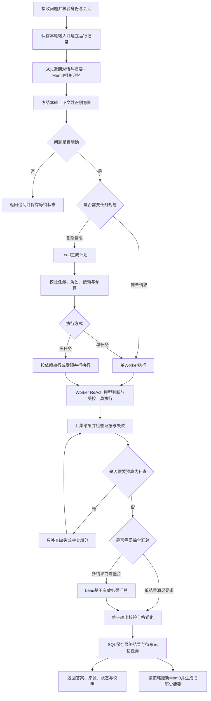

# 医疗科研 Agent 完整修改计划

2026-10-14批次L：常规医学问答现为Lead规划→单/多Worker→汇总（多任务）→实时Reviewer→SQL与维护。审核逐句核对固定原文和policy，不获充分支持的句段省略并返回partial；审核本身仍需独立校准。缺引用补查丢资料缺陷已复现修复，新增可区分命中/引用选择的持久诊断；历史初始命中数未记录，无法追认。187项回归通过，剩余10题真实/独立来源评测完成，dev20覆盖核对完成但非同版20/20临床通过。Dot正文18份、建议60项与10候选题已接收，正式知识库与冻结测试集不动。详情见[批次L验收](批次L实时Reviewer与开发集续评验收.md)。

2026-10-14批次K：独立来源审查工具已具，dev20/60要点与首批10题答案逐项核对（专业复核pending）；运行时新增有限紧急风险规则出口，普通请求仍由Lead选择单/多任务。178项后端回归通过，本批新6题真实5完成/1失败。实时逐事实Reviewer、另10题dev质量与缺引用诊断未完成，不能把工程evidence passed当医学支持。Dot继续云端资料/候选题搜集，目标约100份可复用去重正文，新版资料统一审核后向量化；当前库与冻结test40保留。详见[批次K验收与补测表](批次K逐项引用与开发集质量验收.md)。

2026-10-14最新进度（批次J）：Lead规划与多任务汇总采用原生结构化提交，保留程序校验，增加安全诊断和预算内每阶段最多一次格式修复；161项后端测试通过，原4道dev真实自动规划全部完成。Dot7条来源元数据已接收，未接收正文/逐点审查JSON，不改冻结题集或正式语料。正式Milvus20份/40片段、TXT候选4份/38片段；医学事实质量仍待复核。详见[批次J验收](批次J规划汇总修复与资料接收验收.md)。前端暂不动，下一步接可读审查交付并核对引用支持。旧H失败报告和以下批次数字保留原边界。

版本：v1.7；日期：2026-10-13；状态：批次A–G完成，查询主图v3、独立登记图v1；123项后端测试、5项前端测试通过。最终同题真实配对单/多各3/3完成，正常Lead HTTP与模拟登记20项检查通过；早期失败分别保留。最新范围、比较指标和限制见 [批次G验收记录](批次G验收记录.md)。默认配置离线，`run.py --real` 显式启用真实provider。执行入口见 [实施路线](实施路线.md)，体验步骤见 [端到端演示指南](端到端演示指南.md)。

2026-10-14更新：医学问答与面试展示优先，H1–H3已完成20份来源、独立医学库40片段、60题（dev20/test40）和真实Lead自动路由入口。136项后端测试通过；4题真实观察2完成/1部分/1失败，H4专业质量评测待开展。见[H验收](医学资料与知识库验收.md)及[医学计划](医学知识库与问答评测计划.md)。前端后续用户重设计；登记保留模拟。四种配置为可选消融，不强制业务Agent任务数；A–G历史证据保持原批次边界。

本文整理实施计划，以流程、职责、问题处理和验收为主。原始参考目录 `medix-agent-swarm/`、`MediX-R1/` 保留；独立backend已具SQL、单Agent和多任务LangGraph，demo-frontend新增联调页。各表仍记录目标设计，当前实际完成范围以批次验收记录为准。

依据：[静态审查](01_SOURCE_AUDIT.md)、[知识模块地图](02_AGENT_KNOWLEDGE_MAP.md)、[逐项改进记录](IMPROVEMENT_BACKLOG.md)。本文是实施主计划；改进清单保留问题编号和原始证据。

## 1. 当前进度与改造目标

核心调用链已基本梳理：接收问题与上下文 → Lead 拆任务 → Coordinator 路由 → Worker 的 ReAct 工具循环 → 本地/网络检索 → Worker 处理结果 → Lead 汇总 → 对话与长期记忆保存。

独立工程已验证真实DeepSeek、Mem0隔离读写、PubMed索引检索与3份合成文档的Milvus/BGE/重排主链；摘要和维护有离线故障测试与真实成功观察。医学答案质量、代表性检索评测、长期摘要保真率及资料中的实验指标仍未验证；当前端到端成功不能替代这些质量结论。

后续目标是：以 LangGraph 明确编排流程，让单 Agent 与多 Agent 都能读取正确上下文、执行受控工具、返回真实状态，并可持久保存和恢复。简单请求保持简单，业务登记采用明确的确认工作流。

| 已确定的设计方向 | 初期默认方案 | 可调整或后续扩展 |
|---|---|---|
| 身份认证 | 本地账号 + 短期 JWT access token；SQL 保存用户与资源所有权 | 企业 OIDC/SSO 适配，按实际身份系统替换 |
| 会话持久化 | SQL 保存完整消息、用户、会话和运行结果 | 本地学习先 SQLite；多人部署评估 PostgreSQL/MySQL |
| 短期上下文 | 最近 10 轮已完成用户对话 + 旧历史摘要 + 当前问题 | 同时受 token 预算约束；轮数可配置 |
| 长期记忆 | Mem0 适配层，按可信用户隔离并筛选写入 | 用户画像、自部署 Mem0 或本地替代实现 |
| 编排 | LangGraph 主图 + Worker ReAct 子流程 | 第一版可封装已修正的 Loop，后续再按需求图化 |
| 对话模型 | DeepSeek API 的 deepseek-flash，初期非思考模式；Lead、Worker、汇总及摘要复用配置 | 根据评测再决定模型分工；当前不微调 |
| 规划与路由 | 复杂任务由 Lead 规划；一个能力用一个 Worker | 简单请求可直接路由；必要时追问 |
| 工具 | 本地知识库与网络搜索按需使用 | 混合检索、重排、正文抓取按实测补充 |
| 输出 | 统一结构契约、证据检查与用户可理解的状态 | Reviewer 按任务需要启用 |
| 业务登记 | 后续独立分支：字段、草稿、编辑、确认、受控写入 | 以真实企业需求和授权接口为准 |

当前已按用户授权完成批次A–G的JWT、会话SQL、单/多任务LangGraph、本地检索、真实provider、记忆维护、SQL模拟登记与配对评测。reranker复用 `D:\rag_project\models\reranker\bge-reranker-v2-m3`，未下载权重；BGE Embedding已在独立目录准备。真实业务Service、医学质量评测、企业认证和部署留待后续；不使用真实患者或公司内部数据。本计划不含模型训练或公开发布。

## 2. 目标请求流程

### 2.1 查询与分析主链路

图是目标设计，不是已实现调用链。每个节点还要有失败、取消和超时出口，不能为了得到文字答案强行走完整条成功路径。

具体约定：

1. 身份来自服务端可信机制；用户不能通过问题、参数或任意 user_id 访问其他人的数据。创建/恢复会话时先校验所有权。
2. 保存输入后查询本轮之前的历史，当前 question 单独追加一次，避免重复。SQL 和 Mem0 在完成身份检查后可并行读取。
3. 所有 Worker 获得同一个上下文快照：原问题、相关近期消息与摘要、筛选的长期记忆、自己的具体任务，以及服务端控制的允许工具和预算。信息按需要裁剪，不把无关用户资料交给全部 Worker。
4. Lead 负责生成计划；程序负责检查和执行。简单任务可绕过 Lead 拆分，但仍经过上下文、工具门禁、输出检查和持久化。
5. 不以子任务数量认定专家数量；分别统计 task_count、distinct_agent_count 和真正完成的任务/角色数。
6. 单任务执行完，经统一检查即可输出；多任务按依赖执行后再由 Lead 汇总。多个任务属于同一角色，也可以由该角色顺序处理，不默认进入多专家并行模式。
7. 模型可以不调用工具；需要资料时按任务权限调用 search_knowledge、deep_research 等能力。网络搜索失败可以使用已有有效资料，但必须说明缺口。
8. 有效结果不足则追问、有限补查或返回 partial/failed；汇总不能把失败任务补写成成功。
9. 保存本轮原问题和最终回复各一次，内部 Worker/工具记录单独保存。筛选长期记忆和旧历史压缩是后续维护，不把所有输出自动上传 Mem0。

### 2.2 业务登记独立分支

G已实现模拟登记：前端显式选择登记输入 → 独立registration_graph_v1规则提取/字段校验 → SQL持久缺字段或待核对草稿 → 编辑升版 → 用户核对并明确确认 → Service再次核验身份/字段/版本/凭据 → 事务幂等写入模拟SQL → 保存结果与审计。待确认状态由SQL而非查询Worker检查点持久保存；通用业务意图/LLM抽取与真实接口留待后续。

编辑使旧确认失效，取消不写入；外部写入结果不明先按操作 ID 查询，禁止直接重写。确认、取消、草稿版本和真实记录保存为结构化状态，不从聊天摘要或 Mem0 推断。该分支可以复用知识检索，但不必经过 Lead 拆成三个专家任务。

## 3. 模块改造清单

优先级定义：P0 为正确性和隔离的基础，P1 为核心持久流程，P2 为效果优化或业务扩展。优先级不代表已经完成。

| 模块 | 修改内容与职责 | 优先级 | 完成标准 | 对应问题 |
|---|---|---|---|---|
| 请求入口与配置 | 新建独立 FastAPI 入口；输入、身份、会话所有权、request/run ID 校验；应用生命周期复用模型/存储客户端 | P0 | 无效输入/越权在读写前拒绝；配置不依赖作者路径；不重复重建全部资源 | FLOW-01、MEM-02、MEM-05、MEM-10、RELEASE-01 |
| 会话 SQL | 用户/会话/消息、顺序编号、运行关联、恢复与保留策略；SQL 是完整对话权威记录 | P0 | 重启不丢历史；跨用户隔离；一次提交不会重复保存输入或最终回答 | MEM-01、MEM-02、MEM-04、MEM-08、MEM-11 |
| 上下文管理 | 最近 10 轮、摘要、当前问题和相关长期记忆组成快照；统一传给单/多任务 | P1 | 多任务不丢背景；不重复拼接；超长时按预算裁剪 | MEM-03、MEM-07、MEM-09、MEM-10 |
| 摘要维护 | 旧消息有损压缩，保存覆盖范围和版本；失败可重试且不删原始消息 | P1 | 10 轮边界正确；修改/否定/未解决事项保留；可从 SQL 重建 | MEM-07、MEM-10，新增上下文策略 |
| Mem0 适配 | 用户隔离、版本契约、搜索/去重、筛选写入、更新删除、故障降级和待写任务 | P1 | 无串用户；失败不伪装无记忆；重复处理不新增重复事实 | MEM-05、MEM-06、MEM-07 |
| LangGraph 主图 | State、节点、条件边、持久 checkpointer、暂停/恢复、取消和状态聚合 | P1 | 单、多、追问、失败及重启恢复路径可追踪；原图与任务状态不冲突 | ARCH-01B、ARCH-02、ARCH-03、ARCH-06、FLOW-05、FLOW-06 |
| Lead 与路由 | 结构化计划、角色枚举、任务上限、覆盖/重复检查、依赖图和失败回退契约 | P0 | 未知角色、非法计划、循环依赖不进入执行；回退保留原因 | FLOW-02、FLOW-07、FLOW-08、FLOW-09、FLOW-10、FLOW-11、ARCH-02、ARCH-03 |
| Worker ReAct | 每次运行独立状态；工具逐次预算、单步与全程超时、分类重试和真实结束条件 | P0 | 并发不串计数；同批工具不超预算；空结果/耗尽/异常有明确状态 | FLOW-03、FLOW-04、FLOW-05、LOOP-01、LOOP-02、LOOP-03 |
| 工具注册与门禁 | 显式可信工具清单；参数模型、范围及额外字段检查；按角色/用户/任务授权 | P0 | 非法参数和未授权调用零执行；不依赖提示词或 warning 授权 | TOOL-01、TOOL-02、TOOL-03 |
| Milvus 知识库 | 分块终止与参数校验、可重复导入、稳定文档 ID、来源/版本、正确分数和过滤语义 | P0/P1 | 长文能终止；导入不重复；失败与无命中区分；引用可追溯 | RETRIEVAL-01、RETRIEVAL-02、RETRIEVAL-03、RETRIEVAL-04 |
| 网络与 DeepResearch | 搜索后端适配、查询/结果/时间预算、域名范围、必要正文、异步阻塞处理和来源保留 | P1 | 摘要和正文明确区分；搜索失败有状态；内部调用全部计数 | RESEARCH-01、RESEARCH-02、RETRIEVAL-02 |
| 结果检查与汇总 | TaskResult/FinalResponse 契约、证据覆盖、冲突、有限补查；单多路径统一出口 | P0/P1 | 有文字不等于成功；失败任务不被摘要隐藏；所有出口通过契约 | OUTPUT-01、OUTPUT-02、OUTPUT-03、OUTPUT-04、ARCH-04 |
| 运行记录与前端 | 本地执行事件、来源、阶段、错误码、实际角色/任务数量；Vue3 展示和恢复操作 | P1 | 用户可区分完成、降级、部分、失败及等待输入；真实重连不重复运行 | FLOW-11、OUTPUT-02、OUTPUT-03 |
| 业务 Service | 独立登记分支、草稿版本、确认、权限、幂等、审计及结果不明恢复 | P2；写入前必做 | 未确认/已取消/旧确认零写入；重试不产生重复记录 | TOOL-02、ARCH-05 |
| 测试与交付 | 离线假模型与故障注入、真实评测分离、运行说明、环境依赖固定和来源边界 | P0起持续 | skipped/failed 不算通过；无虚构指标；可从独立工程复现 | EVAL-01、RELEASE-01 |

## 4. SQL、短期窗口与摘要设计

### 4.1 数据保存与上下文使用分开

SQL 保存完整用户对话。默认给模型最近 10 轮已完成对话，不是数据库只保留 10 轮；更早对话形成摘要，原文仍按配置的保留/删除策略存储。

一轮指“一次用户输入 + 对应的一次最终助手回复”，最多约 20 条用户可见消息。工具消息、Worker 内部输出和重试事件不占用户对话轮数。等待追问和未完成请求按实际状态保存，不能凑成已完成轮。

上下文结构：角色与任务规则 + 旧历史摘要 + 最近 10 轮 + 相关长期记忆 + 当前问题。真实任务/草稿状态以结构化数据单独传入。

10 轮是默认上限，仍要满足总 token 预算：先去掉无关长期记忆或冗长工具内容，再压缩/减少近期窗口，并记录裁剪范围。当前问题、关键约束和业务状态不能无声截断。各部分的数值预算在选定模型上下文后配置，不提前宣称容量足够。

### 4.2 初期数据表职责

| 表/存储 | 主要信息 | 规则 |
|---|---|---|
| users / sessions | 可信 user_id、可选 tenant_id、会话所有权、标题与状态 | 本地使用合成用户身份适配；企业认证后接可信身份 |
| messages | session_id、递增 seq、role、content、run_id、reply_to、时间 | 序号/请求键唯一；仅保存用户可见对话；支持按序分页 |
| session_summaries | 内容、covered_until_seq、输入区间、版本、生成状态 | 与原消息关联；越界、旧版本和重复覆盖不生效 |
| runs / tasks | request_id、run_id、计划、子任务、终态、阶段失败、预算 | task_id 稳定关联；同一请求重试返回已有运行 |
| execution_events | 节点、工具、耗时、调用次数、错误码、来源引用 | 内部轨迹与用户消息分层；不记录凭据或完整敏感参数 |
| memory_jobs | 筛选结果、来源消息 ID、操作键、状态、重试/远端 ID | 用于本地持久待写和远端结果核对，不能声称跨云事务原子性 |
| LangGraph checkpoints | 当前流程状态、待恢复节点、图版本、绑定标识 | 使用持久后端；与消息表职责分开，可同一数据库不同表 |

不要求第一阶段建全量复杂用户系统；先落实所有权、唯一键与事务，再扩展多租户。SQLite 为本地工程默认，部署数据库选型不在本次锁死。

### 4.3 摘要更新流程

1. 当前轮完成并持久保存后，检查是否存在尚未覆盖、且已退出 10 轮窗口的完整旧对话。
2. 读取“现有摘要 + 新退出窗口的原始消息”，生成新摘要；不要反复仅压缩上一个摘要而丢掉出处。
3. 保留主题、用户明确事实与偏好、已纠正信息、重要结论及其来源、待解决事项；模型猜测和失败文案不得变成事实。取消/确认状态仍以业务表为准。
4. 保存覆盖区间和输入版本，使用版本检查提交；同会话并发请求先串行化或返回冲突，避免摘要覆盖新消息。
5. 摘要失败继续使用旧有效摘要和预算内近期消息，记录 summary_status；不删除历史，不伪称压缩成功。
6. 定期按原消息重建以减少累积失真；修改/删除历史时使相关摘要失效并重建。首次实现用本地假摘要器验收，真实模型压缩后另评估保真度。

## 5. Mem0 长期记忆与用户画像

保留 Mem0 作为本轮选定的长期记忆接口方向，包在 MemoryProvider 适配层内；第一阶段使用本地 fake 实现，不连接云端。SDK/API 版本与返回结构在接入时固定，不照抄参考工程旧版参数。

### 5.1 读取

服务端认证后使用可信 user_id（多租户时再加租户范围）搜索与当前问题有关的少量记忆，按稳定 ID/实际内容去重，保留来源、时间和版本。空命中与请求失败分开；记忆仅为背景，不能覆盖系统规则或授权决定。

Mem0 官方要求检索按用户范围过滤；应用仍需自行验证请求身份和会话所有权。[官方检索说明](https://docs.mem0.ai/core-concepts/memory-operations/search)

### 5.2 写入与修正

| 信息 | 初期处理 |
|---|---|
| 用户明确表达的稳定偏好、专业背景、持续目标 | 可以筛选为长期记忆，记录原消息 ID 与时间 |
| 用户纠正此前事实 | 更新/使旧记忆失效，保留来源关系 |
| 临时问题、无长期价值的输出 | 保留在 SQL，不写 Mem0 |
| 模型推测、未经证实的诊断、错误/失败文案 | 不提升为用户事实 |
| 有价值的研究结论 | 必须保留出处与有效期；优先作为证据/知识资料管理，不默认变成画像 |
| 身份权限、草稿确认、实际登记结果 | 以认证/业务 SQL 为准，Mem0 不承担权威状态 |

先按明确白名单筛选，必要时模型提出候选、程序再验证。记录 added/updated/skipped/pending/failed；删除或纠正同时处理 SQL 摘要、远端记忆及待写任务，避免过时记忆再被检索。

SQL 保存结果和 memory_jobs 使用本地事务；后台处理 Mem0 更新，不阻塞正常回答。通过操作键、远端 ID、查重及结果核对降低重试重复，不假设 Mem0 与 SQL 有共同事务或所有接口都支持幂等。回答返回时如尚未处理，memory_write_status 必须为 pending；后续可查询更新。

Mem0 add 可以包含信息抽取等处理，接入时要核对已固定版本的抽取策略和结果状态，不因请求接受就宣称记忆可检索。[官方添加说明](https://docs.mem0.ai/core-concepts/memory-operations/add)

### 5.3 画像是后续扩展

初期考虑职业/科研角色、领域兴趣、回复语言和详略偏好、持续项目背景；用户应能查看、纠正和删除。画像以用户明确事实和已授权来源为依据，不自动推断患者身份或疾病。需要精确查询的结构化画像字段可存在 SQL，Mem0 用于相关语义背景，二者更新来源和版本保持一致。

## 6. LangGraph、规划与执行控制

### 6.1 职责映射

Coordinator 的编排职责迁入图构建和运行服务；Lead 的模型规划/综合能力保留为节点，三个 Worker 保留为角色与工具执行能力。程序校验、路由、保存和 Service 不默认都成为独立 Agent。

此前 ARCH-01A 的 Python 显式 Workflow 方案保留为比较基线；本轮选择推进 ARCH-01B 的 LangGraph 方案。两种方案共有的身份、字段、状态和副作用边界继续适用。

| 图节点 | 职责 | 失败处理 |
|---|---|---|
| validate_request | 身份、会话、请求键和输入检查 | 越权/无效请求直接拒绝 |
| load_context | SQL 对话/摘要、相关 Mem0 记忆、上下文快照 | SQL 历史不可用先报错；允许无记忆模式时显式说明 |
| route_intent | 简单任务、复杂查询、追问或业务登记 | 不确定则澄清，禁止猜写入意图 |
| plan / validate_plan | Lead 计划及程序校验 | 初期最多一次格式修正；仍无效则可解释回退或失败 |
| execute_tasks | 单 Worker、按依赖串行或受限并行 | 每个任务独立终态；不无限等待无人处理任务 |
| review / refine | 检查来源、遗漏、失败和冲突；有界补查 | 初期最多一次定向补查；不足则保留 partial |
| synthesize | Lead 综合有效结果，单结果可跳过 | 返回已验证结果摘要及明确汇总失败，不能标全成功 |
| validate_response | 结构、证据引用、业务状态与展示检查 | 有界修正；仍无效走统一失败出口 |
| persist_result | 消息、最终状态、维护任务落库 | 保存失败不能声称结果已持久化；保留可查询恢复线索 |
| memory / summary jobs | 长期记忆和摘要维护 | 可重试后台任务，状态单独报告 |

图主要 State 保留标识、上下文快照/引用、计划、按 task_id 合并的结果、预算、错误与状态。并行结果使用明确合并规则，不让多个 Worker 任意覆盖全局状态。客户端和数据库连接属于应用资源，不存进可序列化 State。

LangGraph 可编排固定工作流和动态 Agent，具体路由仍由本项目定义。[官方工作流说明](https://docs.langchain.com/oss/python/langgraph/workflows-agents)

### 6.2 会话与恢复

会话session_id、单次run_id、子任务task_id和checkpoint的thread_id分别定义。批次B选择每次运行一个服务端生成的run:<run_id>检查点线程，避免旧轮工具协议污染；会话连续性由SQL窗口提供。同会话最多一个活动运行，等待/暂停先恢复或取消，不能用新问题覆盖。未来业务确认仍绑定具体运行和草稿版本。

SQL 消息是完整聊天来源；checkpoint 是运行进度来源；组装上下文时不同时回放 checkpoint 全历史和 SQL 全历史。模型上下文只保留本轮需要的窗口和当前调用协议。

本地采用持久 SQLite checkpointer，部署时评估 PostgreSQL 等后端；仅用内存 checkpointer 不满足重启恢复。恢复校验身份、图版本和副作用状态，已完成的业务操作不因节点重放重复执行。[官方持久化说明](https://docs.langchain.com/oss/python/langgraph/persistence)

人工暂停的节点恢复时可能重新执行节点前面的代码，因此受控写入与确认暂停分别放置，另用操作键和 Service 查询保护副作用。[官方 Interrupts 说明](https://docs.langchain.com/oss/python/langgraph/interrupts)

### 6.3 执行预算与异常

预算至少包含主流程模型调用、每个 Worker 模型调用、工具次数、内部搜索次数、输出 token、单步超时和整轮截止时间。具体时间/数量在实现前配置为可调值；任何隐藏的总结或 DeepResearch 内部调用也计入。

工具每次执行前检查预算和权限；耗尽后实际禁用工具，有依据则返回 partial，无有效结果则 failed。网络/限流等暂时故障可按截止时间有限重试，参数错误和权限拒绝不反复执行。同一 Worker 的多个任务不共享计数；初期限制并发，并将同步检索/搜索放入受控执行器。

工具回放保留 assistant 的调用 ID 和匹配 tool 消息；取消或重试不能留下孤立消息。可恢复只读调用与副作用调用区分处理，不以通用异常循环代替恢复策略。

## 7. 工具、知识与输出契约

### 7.1 工具与检索

- 可信注册表替代任意目录动态执行；每个工具显式描述输入、输出、允许角色、是否联网、是否有副作用及预算。
- 用明确参数模型生成 Schema，并在执行前验证必填、类型、整数/范围和额外字段；工具不存在、越权或参数无效均返回安全错误码，不执行函数。
- Milvus 先解决长文本分块终止、导入去重、ID/版本、分数及过滤语义，再评估 BM25、重排与医学专用嵌入模型。保留现有实现作为比较基线，不为框架迁移自动换模型。
- 资料只用公开或合成且可追溯内容；注明原始出处、版本、日期及核验状态。检索命中不是医学正确性保证。
- 搜索结果保留标题、URL、摘要、检索时间和正文是否获取；必要时抓取允许范围内的正文，引用明确指向依据。
- deep_research 的参数改为子查询数/结果预算等真实含义；独立记录内部模型与搜索调用，不再用 max_iterations 暗示未接入的循环。
- 搜索/检索失败、无命中和部分结果分别表达；网页正文与历史记忆都是外部数据，不能改变工具权限或系统规则。

### 7.2 输出与证据

至少定义 Plan、ToolArguments、ToolResult、TaskResult 和 FinalResponse 五类契约。JSON 可解析、字段结构有效、业务语义成立、真实操作成功分别检查，不把四者混为一次 JSON 校验。

TaskResult 包含 task_id、实际 agent_id、status、有效结果、证据引用、缺口和安全错误码；FinalResponse 包含 answer、sources、limitations、总体状态和实际完成摘要。界面从结构化数据渲染，不再依赖“【段落标题】+正则”猜字段。

证据检查优先使用确定性 ID/引用、来源与覆盖规则；必要时 Reviewer 辅助内容核查。模型自报 confidence、文献一词出现次数和固定 evidence_provided=True 均不能作为正确性指标。来源矛盾保留并说明，最多有限补查，不强制三方辩论或多数表决。

## 8. 真实状态、失败反馈与前端

### 8.1 状态分层

| 字段 | 含义 | 初期值示例 |
|---|---|---|
| run_status | 当前运行生命周期 | queued / running / awaiting_input / awaiting_confirmation / finished / failed / cancelled / timed_out |
| result_status | 回答或业务结果是否完整 | completed / completed_with_fallback / partial / failed；未产出结果时为 null |
| plan_status | 规划是否执行及成功 | skipped / completed / repaired / failed |
| task_status | 每个任务真实状态 | pending / running / completed / failed / cancelled / timed_out / blocked |
| context_status | SQL/摘要/Mem0 背景是否完整 | complete / degraded / unavailable；并保留各来源状态 |
| persistence_status | 本轮结果是否可靠保存 | saved / failed / pending |
| memory_write_status / summary_status | 后台维护状态 | skipped / pending / completed / failed |

总体返回还带 request_id、run_id、session_id、阶段、actual_agents、fallback_used、safe_error_code、user_message 和可恢复操作。没有发生的步骤用 skipped/null，不用虚构零值证明质量。

### 8.2 常见失败的约定

| 场景 | 系统处理 | 用户可见结果 |
|---|---|---|
| Mem0 查询失败 | 使用可靠 SQL 背景，记录上下文降级 | 若影响回答则 partial；若满足任务仍可 completed_with_fallback，明确长期记忆不可用 |
| 历史 SQL 读取失败 | 默认不假装加载成功；可配置新会话无历史模式 | unavailable/failed 或明确的无历史降级 |
| Lead 计划非法 | 有界修正；允许的只读任务可单 Worker 回退 | plan_status=failed，fallback_used=true，保留原因 |
| 一个非关键任务失败 | 汇总有效部分并列缺口 | partial；关键前置任务失败阻断依赖任务 |
| 联网搜索无命中或失败 | 区分两者，按任务判断本地资料是否足够 | 明确未找到资料/搜索不可用，不冒充联网验证成功 |
| 工具越权/参数错误 | 执行前拒绝 | 安全错误说明；不会自动放宽权限 |
| Lead 汇总失败 | 返回已通过检查的任务摘要或统一错误 | partial/failed，synthesis 阶段失败可见 |
| Mem0 写入失败 | 保留待写任务，有界重试/结果核对 | 原回答状态可保留，记忆更新单独 failed/pending |
| 用户取消或全程超时 | 终止后续调度；查询已开始副作用结果 | cancelled/timed_out；可能已提交的写入不声称已撤销 |

是否 partial 取决于失败是否影响任务完成，不因某个非关键后台任务失败就抹掉已完成业务，也不因有答案就抹掉关键失败。

Vue3 前端接入会话列表、继续旧会话、阶段事件、最终状态、来源和错误说明。支持重连按 run_id 获取真实状态，避免重复提交；取消是服务端状态操作。用户只看到安全可理解的信息，原始异常、内部路径和凭据不直接展示。现有 localStorage 演示与新后端数据源明确标识。

## 9. 实施顺序与交付物

阶段按依赖推进，不承诺未经评估的工期。优先做一条可验收的单 Agent 纵向链路，再增加多 Agent 和外部服务。

| 阶段 | 工作范围 | 交付物与进入下一步条件 |
|---|---|---|
| 0：独立工程与契约 | 建 backend；固定配置、请求/结果/状态模型；保留参考源码；做会话身份适配 | 能离线启动；无凭据读取/云请求；文档标明模拟模式 |
| 1：会话 SQL 与上下文 | 消息保存/恢复、用户隔离、10轮窗口、fake Mem0、fake 摘要 | 重启可继续历史；A/B用户不串；11轮边界和超长输入测试通过 |
| 2：单 Worker 的 LangGraph 纵向链路 | 持久 checkpoint、直接路由/Lead规划、假模型和可信假工具、统一输出保存 | 单 Agent 可完整运行、预算受控、失败/取消/重启可解释；前端能展示真实模拟运行状态 |
| 3：多任务与证据汇总 | 计划语义校验、依赖、受限并发、局部状态、Lead汇总、定向补查 | 同角色多任务不串计数；部分失败不冒充全成功；依赖顺序正确 |
| 4：真实本地知识库 | 先复现并修复分块等缺陷；独立临时库导入公开/合成数据 | 导入去重与出处可追溯；离线检索契约通过；不覆盖原DB；模型准备/下载另按授权执行 |
| 5：真实模型、网络与Mem0 | 各适配器逐个接入，固定版本、预算、来源规则和维护队列 | 每种外部请求范围明确；先小样本真实观察，再记录延迟/质量；不与离线结果混计 |
| 6：记忆压缩与可靠恢复 | 真实摘要保真、纠正/删除、pending记忆核对、故障恢复 | 旧摘要可重建，错误不强化，云失败不丢本轮对话，跨重启不重复写入 |
| 7：前端整体验收与评测 | 会话恢复、事件、来源、失败反馈、配置和运行指南 | CLI/API/UI状态一致；模拟和真实清楚区分；评测材料可复现 |
| 8：业务登记扩展 | 根据真实需求实现确认、取消、权限、幂等Service与审计 | 离线模拟写入验收先通过；真实系统接入另确认业务契约和范围 |

前端与摘要的离线实现可以随阶段提前配套；阶段顺序表示核心依赖，不要求串行等待所有辅助工作。长期记忆搜索、查询规划、工具和总结的真实质量都在阶段 5 之后单独测量。

建议独立工程职责目录：api、schemas、graph、agents、tools、services、repositories、memory、retrieval、observability、tests。目录按必要职责建立，不机械拆成大量空模块；模型/工具/存储通过适配器替换，支持默认离线假实现。

## 10. 验收用例与指标

实现时对可复现缺陷先写失败测试，再修复；不执行原 examples/test_all.py 作为离线验收，不把跳过和吞错算通过。

| 验收主题 | 必须覆盖的用例 |
|---|---|
| 身份与持久化 | A/B用户隔离、伪造会话拒绝、重启继续、请求重试不重复消息、同会话并发处理 |
| 10轮与摘要 | 0/10/11轮、已覆盖区间不重复、否定/纠正保留、摘要失败、超长窗口、删除后摘要失效 |
| 长期记忆 | 无命中与不可用、重复去重、旧事实纠正、失败/取消不记为事实、待写重试与结果不明核对 |
| 规划与路由 | 无效JSON、缺字段、未知角色、重复/过量任务、循环依赖、同角色多任务、简单任务绕过规划 |
| ReAct与工具 | 直接回答、工具回填、一次多调用预算、非法整数/范围/额外字段、越权零执行、独立计数、超时取消 |
| 检索与网络 | 长文分块终止、导入重复、分数/过滤契约、无命中/故障、来源丢失、摘要与全文区分、内部预算 |
| 输出与汇总 | 单多路径同契约、一个任务失败、全部失败、证据冲突、预算耗尽、总结失败、未验证证据不能标真 |
| 暂停与恢复 | checkpoint重启、thread所有权、等待输入、恢复图版本不符、写入结果不明先查询 |
| 业务登记扩展 | 缺字段追问、编辑使旧确认失效、取消零写入、重复确认不重复登记、无权限零写入 |
| 前端 | 状态/来源/安全错误显示、断线重连、取消反馈、模拟标识、恢复旧会话不重复调用 |

分开报告三类证据：确定性离线测试、授权后的真实模型/检索观察、真实业务系统验收。测试结果记录 passed/failed/skipped；当前计划没有执行新工程测试。

真实评测记录数据集版本、样本分母、正确路由/字段有效/任务完成分别计分、来源支持度、延迟分布、模型/工具调用量和 token。比较单 Agent 与多 Agent 使用相同问题和预算口径，不宣称多角色数量等于质量提升，不沿用手册的百分比。

## 11. 第一版完成定义与后续选择

第一版完成需做到：独立后端 + LangGraph查询主链 + SQL完整历史 + 10轮窗口与可追溯摘要 + 隔离的MemoryProvider + 单多任务正确路由 + 工具参数/权限门禁 + 有界ReAct + 证据与输出契约 + 持久恢复 + Vue3真实状态展示，并通过离线验收。真实模型/Mem0/网络接入若未获授权，继续使用明确的假实现，不宣称外部集成完成。

实施前仍需在对应阶段明确：DeepSeek 的具体模型/模式、调用预算与账户配置、SQL部署后端、Mem0版本及可上传信息、知识资料来源、网络搜索范围与正文获取策略、真实登记接口与企业认证规则。本地认证和模型服务方向已确定，见第 12 节；这些后续选择不阻止先做离线工程。

后续增强放在基础可靠之后：用户画像、混合召回/Reranker、按需要的Reviewer、较复杂研究细化和真实业务扩展。暂不加入模型训练、自动学习未经核验医学结论、全面微服务拆分或云监控平台。

推进方式：每次按一个阶段/一条纵向流程实施，交付简洁代码、流程说明、对应测试和明确的已验证/未验证清单；本文件随真实结果更新，改进编号用于追踪完成情况。

## 12. 鉴权、账户准备与初期模型方案

本轮补充日期：2026-10-13。这里只确认设计方向，不注册账户、不读取密钥、不充值或调用付费 API。

### 12.1 本地先使用 JWT

登录校验 SQL 用户和密码哈希 → 后端签发短期 JWT → 前端发送 Bearer token → 后端验证签名、允许算法、有效期等，再取 sub 对应的当前用户 → 验证会话/资源所有权和具体操作权限。

JWT 用于确认请求身份；权限仍由服务端用户、角色和资源规则检查。Mem0 的 user_id、SQL 查询用户范围和 checkpoint 所有权均来自这个已验证身份，不接受问题或客户端任意指定身份。JWT 仅放必要标识与时效信息，不放医学内容或服务密钥。

初期单后端可以采用 HS256 与独立生成的服务端签名密钥；密码使用 Argon2 哈希。前端 access token 初期放内存，过期重新登录；若需要长时间登录再加可轮换/撤销的 refresh session，避免第一版引入无用复杂度。首次测试使用合成账号；企业上线接既有 OIDC/SSO 和权限体系，JWT 验证适配其 issuer、audience 及公钥。

验收增加：无 token、过期、签名篡改、错误算法、禁用用户、伪造 user_id 和跨用户会话访问均被拒绝；有合法 JWT 但无操作权限仍然零写入。JWT 内容签名不代表加密，设计按最少字段处理。[FastAPI 官方 JWT 与密码哈希说明](https://fastapi.tiangolo.com/tutorial/security/oauth2-jwt/)

### 12.2 Mem0 云服务账户准备

用户已完成托管 Mem0 注册并取得 API Key，初期采用 Hobby 免费套餐；账户有效性及剩余额度尚未核验。一个应用后端使用开发者账户密钥，终端用户在本应用登录即可，不要求每个用户另行注册 Mem0；保存/检索始终绑定各自可信 user_id。[官方 Quickstart](https://docs.mem0.ai/platform/quickstart)

后端配置 MEM0_API_KEY，密钥不放 Vue3 源码、浏览器或版本库，也不通过聊天提交。注册后再确认项目可用额度、SDK 版本及返回契约。Mem0 自部署可作为后续替代，当前阶段先做 fake MemoryProvider，账户准备不阻塞离线开发。

### 12.3 模型先用 DeepSeek API，不微调

Lead 规划、Worker 工具决策与回答、汇总及历史压缩先复用可配置的 deepseek-flash，减少接入变量；按真实评测再考虑角色分配不同模型。初期显式使用非思考模式，模型名已按官方文档核对，配置见独立 backend/.env.example。

DeepSeek 提供 OpenAI-compatible 接口，并有 Tool Calls 文档；可通过模型适配器接到 LangGraph。工具参数、返回结构和业务规则仍在程序端校验，不假设兼容接口意味着所有高级特性完全相同。[首次调用说明](https://api-docs.deepseek.com/)、[Tool Calls](https://api-docs.deepseek.com/guides/tool_calls/)

开发者在 [DeepSeek 开放平台](https://platform.deepseek.com/) 注册/登录，创建 API Key，确认 API 账户可用余额；余额不足时按需充值。API 计费取决于具体模型和 token 用量，实施前设置单轮/测试预算，当前不自动充值或发起真实请求。[官方计费说明](https://api-docs.deepseek.com/quick_start/pricing/)

后端配置 DEEPSEEK_API_KEY、base_url 和 model；模型 Key、Mem0 Key、JWT 签名密钥是三种独立凭据，不相互复用。知识库向量化仍由单独的 Embedding 模型承担，当前默认 BGE 方向；接入 DeepSeek 对话 API 不自动替换 Milvus 的向量模型。

当前不进入 MediX-R1、LoRA 或其他微调训练。先用提示、检索、工具与状态控制实现可评测基础流程，再判断是否存在值得微调解决的稳定问题。真实 DeepSeek/Mem0 集成在账户配置及调用范围明确后进行，本轮仅更新计划。

## 2026-10-14 M批实施状态

后端已实现原子事实拆分、一次证据约束改写及分批复审；SQL持久计数、状态、两轮来源记录和原稿位置，全部共享预算。comparison-06核心恢复，197项离线回归通过，6题同版本真实观察4完成/2部分。Reviewer仍有实际误判，专业审核及同版本dev20全集复验未完成。

Dot最终交付已核对本地字节/hash、候选题完整schema和quote/policy绑定；100目标适格来源族另2用途隔离，60候选题先暂存。下一步独立来源/许可审核、专业争议处理与家族隔离，再冻结新语料版本统一向量化。前端、冻结题集和原参考代码不改。证据及后续缺口见[批次M验收](批次M原子事实与改写复审验收.md)。

## 2026-10-15 N批实施状态

失败审核输入与类型合法输出现在可按轮次/批次/全局index从本人SQL运行详情追溯；补了未知响应/ID不泄漏、政策例外必须绑定真实规则、原生条件schema有效性保护。basic-07/basic-16目标复验均恢复完整核心；206项回归，4道dev Reviewer全完成、终态2完成/2部分。邻近问题仍有语义误判，不把模型审核视作医学认证。下一步完整dev20同版本核对与更多正反校准；资料许可/专业准入和家族隔离继续待办。前端、冻结测试集、正式与Dot候选语料、用户配置及原参考不改。见[批次N验收](批次N审核溯源与分类校准验收.md)。
