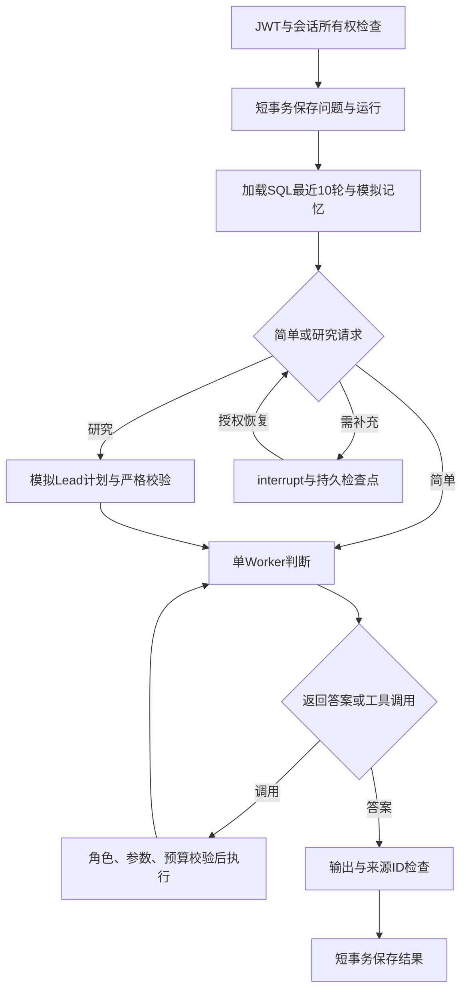

# 批次 B：单 Agent LangGraph 主链

日期：2026-10-13；状态：已实现并验收。应用使用真正的 LangGraph StateGraph 和持久 SQLite checkpointer；模型、工具及长期记忆仍是明确标识的本地模拟实现。未调用 DeepSeek、Mem0 或联网检索。

## 1. 实际链路

每个节点执行前检查取消、运行租约与整体截止时间；模型/工具调用有单步截止时间。失败、超时、预算耗尽和取消都有真实出口。简单请求跳过规划；研究请求只接受一个合法任务，多任务在批次C实现。

路由和模型行为当前是离线脚本式模拟，示例关键词用于验收，不是已证明的LLM语义路由效果。节点是真实图执行；“3次模型调用”代表fake provider的方法调用，不是DeepSeek费用请求。

## 2. 模块职责

| 文件 | 实际职责 |
|---|---|
| backend/app/workflow.py | 图节点/条件边、10轮上下文、每运行预算、工具回填、租约、检查点、恢复/取消、结果保存 |
| backend/app/agent.py | 单任务Plan、Decision、ToolCall、参数/工具结果契约；模拟模型、按用户筛选的模拟记忆、可信只读工具 |
| backend/app/service.py | 资源归属、安全错误、对外结果白名单；旧手写处理循环已移除 |
| backend/app/database.py / models.py | 保留批次A数据的增量结构升级；运行详情、取消标记、事件唯一键及单会话活动运行约束 |
| backend/app/main.py / schemas.py | 兼容旧API，增加进度、事件、恢复、取消接口及明确终态 |
| demo-frontend/src/BackendPanel.vue | JWT内存登录、真实SQL会话、发送/补充/恢复/取消、节点记录与资料来源展示 |
| demo-frontend/vite.config.ts | /api同源转发到本机8010，解决浏览器跨端口访问问题 |

LangGraph/SQLite组件版本：langgraph 1.2.15，langgraph-checkpoint-sqlite 3.1.2；完整依赖环境记录在backend/requirements-lock.txt。LangSmith是依赖组件之一，图执行及provider线程显式关闭追踪，不接云追踪。

## 3. 存储与恢复约定

- SQL保存完整消息，模型背景使用最近10次用户提问及对应可见回复。失败/取消的历史保持原状，不提升为事实。
- 当前问题仅拼接一次；同会话执行顺序化，等待补充/暂停期间新请求明确409，先恢复或取消。
- history字符预算默认16,000，过量时按完整轮裁剪；旧历史仍在SQL，summary_status=not_implemented，older_history_omitted明确标识。真实摘要和实际模型token预算在后续批次实现。
- 应用SQL与检查点分别位于backend/data/app.db、backend/data/checkpoints.db。每轮使用服务端生成的run:<run_id>作为thread_id，避免上一轮工具协议污染新轮。会话连续性由SQL上下文提供。
- 工具协议保留assistant调用ID及匹配tool消息；被预算/权限拒绝的调用也明确配对未执行结果。
- checkpoint只存可序列化运行数据，不放JWT、API Key、签名密钥或客户端连接。公开API不返回原始图State；所有运行/事件/恢复接口检查当前用户所有权。
- 恢复使用真实LangGraph interrupt / Command；校验检查点版本和当前ID，拒绝过期请求。补充内容先持久保存，重复恢复不重复追加消息。
- 运行租约保护跨实例执行；异常进程的租约到期后可恢复/取消。恢复中的只读步骤可能重放，调用尝试预算先落SQL；不承诺provider调用恰好一次。
- 模型和工具不占用SQL长事务。Python已开始的只读函数不能强制终止；取消/超时会忽略其晚到结果，拒绝继续调度和写入结果。

## 4. 预算与输出

初期默认：模型调用尝试最多5次（含Lead），工具执行尝试最多2次，Worker最多3轮；单步10秒，单次执行30秒。用户补充等待时间不计入活跃执行期限，恢复后重新计时，已有调用计数保留。

工具执行前逐个校验白名单、角色范围、字段、严格整数/范围和额外参数。工具全部只读且模拟；批内不超总预算。输出非空/长度、来源引用存在性和来源ID去重均校验；格式成立不证明医学正确性。

完成为finished/completed；预算耗尽且有可用资料为finished/partial；失败、取消和超时分别为failed、cancelled、timed_out。等待补充为awaiting_input；中途暂停为paused。原批次A的模型次数和图版本保持null，不伪填0。

## 5. 用户操作

启动命令沿用 [backend README](../backend/README.md) 与 [前端 README](../demo-frontend/README.md)。访问 http://127.0.0.1:5178，点击“后端联调”，注册自己的本地测试账号或登录，创建会话。

- “你好”：直接Worker回答，跳过Lead，通常1次模拟模型调用、0次工具。
- “检索研究项目资料”：Lead计划、Worker请求工具、结果回填、再次回答，通常3次模拟模型调用、1次工具。
- “请澄清我的请求”：等待补充；填写“检索样本管理资料”，点击恢复，继续同一个run_id。
- 等待补充时点击取消：SQL保存cancelled终态，后续可在该会话提出新问题。

请求重试保持request_id；恢复重试保持checkpoint_id和相同补充内容。登录凭证只在页面内存中；刷新或过期后重新登录，再选择原会话加载历史。

新API：GET /sessions/{id}/runs、GET /runs/{id}/events、POST /runs/{id}/resume、POST /runs/{id}/cancel。恢复body含checkpoint_id，可含clarification。接口文档位于 http://127.0.0.1:8010/docs。

原“登记工作台/登记记录”仍是浏览器合成业务演示，不会自动变成后端业务登记；新联调页只保存对话和运行。

## 6. 验证证据

- 后端确定性离线验收：passed=46，failed=0，skipped=0，包含批次A的23项回归及批次B的23项用例。
- 覆盖直接/计划/工具路径、10轮窗口与当前问题去重、同批工具预算、模型总预算、参数和角色拒绝、输出/引用校验、模拟记忆用户隔离。
- 覆盖真实interrupt重启恢复、中途plan检查点恢复且不重做规划、重复恢复、恢复提交后执行中断、过期检查点、运行列表与恢复跨用户拒绝。
- 覆盖活跃取消不被SQL写锁阻塞、单步超时、旧执行者不覆盖新租约、旧数据库增量升级及重复启动不丢记录。
- 部分结果来源去重与租约接管问题均先由失败测试复现，再最小修复。
- 前端原流程测试：passed=5；Vue TypeScript/Vite构建通过；pip check无依赖冲突。
- 本机HTTP冒烟通过；Vue3浏览器已验证注册/登录、建会话、工具循环、补充/恢复、取消、凭证过期后重登录及旧会话历史读取；浏览器error/warn日志为空。
- 1280及390宽度DOM检查均无水平溢出，临时视口已恢复。桌面运行状态截图见demo-frontend/qa/langgraph-desktop.jpg；in-app浏览器全页截图不可用，保存的是默认视口实际截图。
- 实际后端DB升级前已保存在backend/data/backups；与备份比较原五张表旧记录保留一致，没有打印数据行或密码哈希。
- 原参考基线153个文件SHA-256比较另核对，未改原源码/原数据库，不执行原项目脚本。

Windows沙箱曾阻止Vite realpath，构建在允许访问已授权工作区的环境完成；没有通过修改应用逻辑或屏蔽错误绕过检查。

## 7. 依据与后续

实现对照 [LangGraph StateGraph](https://docs.langchain.com/oss/python/langgraph/graph-api)、[持久检查点](https://docs.langchain.com/oss/python/langgraph/checkpointers)、[Interrupts](https://docs.langchain.com/oss/python/langgraph/interrupts)，前端代理对照 [Vite官方说明](https://vite.dev/config/server-options#server-proxy)。运行线程/租约、SQL权威记录、权限与参数门禁属于本工程实现，框架不会自动替代这些检查。

仍未实施：多任务调度、真实模型/云记忆/检索、旧历史压缩和长期记忆写队列、业务登记Service、企业SSO及生产部署。下一步按路线推进批次C；真实provider在批次E逐项小规模验收。
