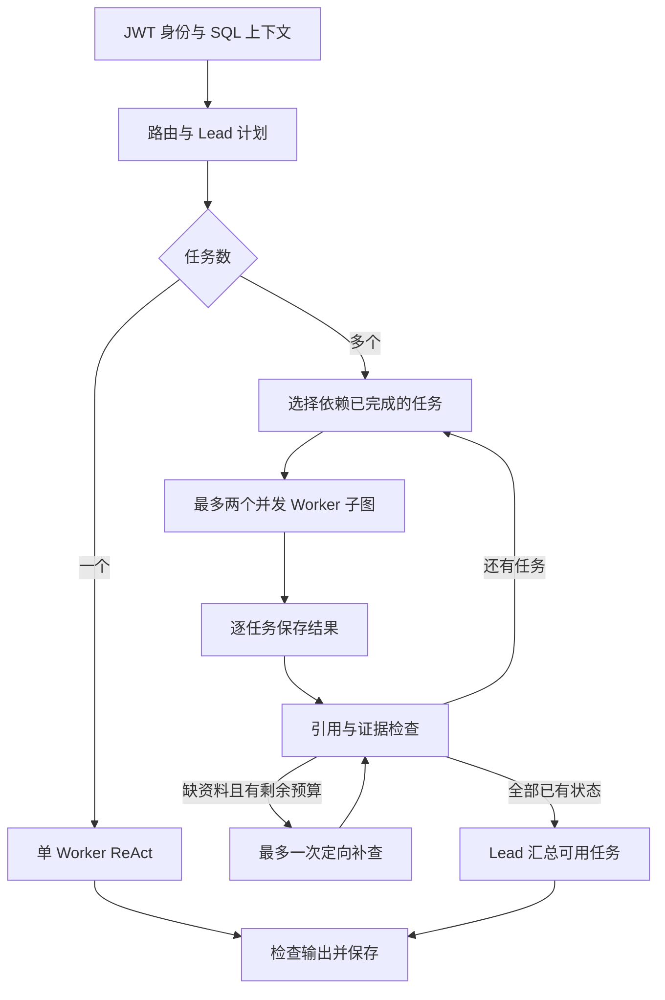

# 批次 C：多任务与汇总验收

日期：2026-10-13。独立 backend 与 Vue3 联调页已实现；原参考目录保持原样。正常服务继续固定 `offline_fake`；真实 provider 冒烟是单独脚本，不代表批次 E 已完成。

## 已实现的流程

- 计划最多四个任务。校验角色枚举、唯一任务 ID、依赖存在性、重复依赖与循环；非法计划返回 `PLAN_INVALID`，不静默交给其他角色。
- 同一角色可以执行多个任务。每个任务复制公共上下文，获得原问题、自己的任务说明和前置结果；使用独立 LangGraph ReAct 子图。工具消息、计数和迭代互不共享，内部任务不写入用户聊天历史。
- 独立任务每波最多两个并发；前置任务失败、超时、取消或证据不合格时，依赖任务标记 `blocked / DEPENDENCY_FAILED`，不启动模型。
- 任务与角色分开统计：`task_count` 为计划任务数，`planned_agent_count` 为计划角色数，`distinct_agent_count` 为实际启动角色数；另有已启动、完成、失败/部分完成、阻塞任务计数及逐任务结果。
- 默认全轮最多 10 次模型、2 次工具请求，包括规划、Worker、补查与汇总。多任务 Worker 默认各最多 3 次模型、2 次工具、3 次迭代；已消耗计数写入 SQL，恢复也不能突破预算。单步 10 秒、全轮 30 秒。
- 证据检查针对实际引用、必需来源与同 ID 内容冲突。整轮最多一次定向补查，继续使用原任务预算；无法补齐的任务标记部分完成。汇总必须覆盖全部可用任务和引用，只接受已完成任务；失败时保留已验证格式的任务输出并返回 `partial`，不冒充完整汇总。
- Vue3 展示逐任务状态、依赖、独立请求数、实际角色数、证据检查、补查次数和带任务 ID 的节点事件。

## 持久化与恢复边界

主图版本升至 2，使用原 SQLite 数据与检查点文件，没有删库。升级前已备份 app.db 和 checkpoints.db，位置为 backend/data/backups/before-c-20261013-190905-*。旧版本已结束记录仍可读取；版本 1 的暂停运行明确拒绝跨版本恢复，可以取消后发起新请求。本机升级前没有等待/暂停/执行中运行。

主图按节点/任务波保存检查点；每个任务终态先独立写入 SQL。即使任务波尚未写出检查点，恢复也会跳过已经持久化完成的任务。尚未完成的 Worker 会从自己的只读循环入口重新执行，已经产生的调用尝试继续计入预算；本批没有对每个 Worker 的每次工具返回单独保存可恢复检查点，不承诺模型/只读检索恰好调用一次。未来写业务工具不能直接复用这一重试方式，须有确认与幂等 Service。

上下文仍为 SQL 最近 10 轮与 fake 用户记忆；旧历史摘要、真实 Mem0 提取/维护、真实知识库和网络检索按 D/E/F 推进。关键词路由和 FakeModel 分解只是可复现的离线演示规则。

## 已验证

| 验证 | 本次结果 |
|---|---|
| 后端离线回归 | 69 项通过，其中 C 新增 23 项，A/B 原 46 项保留（版本断言随主图升至 2） |
| 多任务关键边界 | 同角色并发、计数隔离、依赖顺序/阻塞、全局预算原子性、补查上限、来源冲突、非法汇总、取消、进程重启与任务波中断恢复 |
| 前端原流程回归 | 5 项通过；TypeScript 与 Vite 构建通过 |
| 真实本地 HTTP | 合成账号、会话、幂等、用户隔离及三任务运行通过，云请求 0 |
| 浏览器联调 | 三个任务完成、三个实际角色、research → review 依赖可见，模拟模型/工具请求为 6 / 1 |
| 原参考代码 | 153 个基线文件，缺失 0、哈希变化 0 |
| SQL 数据保留 | 升级前 66 条记录逐行比较一致 |

复现：backend/test.ps1；启动 backend/run.py 后运行 backend/scripts/smoke.py；前端 `npm test`、`npm run build`。正常服务 /health 返回 `langgraph_task_dag`、graph_version=2、external_calls_enabled=false。

浏览器截图：demo-frontend/qa/batch-c-tasks.jpg；重新登录后可从SQL读取同一会话与多任务状态，浏览器错误/警告日志为空。

## 真实 provider 单独冒烟

执行时间：2026-10-13 19:05 北京时间；脚本 backend/scripts/provider_smoke.py，需要显式 `--run` 才联网，普通测试不读取用户密钥或调用云 API。原始安全计数记录：tmp/provider-smoke-20261013-190535.json。凭据仅由程序读取，不输出；没有修改 .env 或升级套餐。

| 服务 | 本次调用与结果 |
|---|---|
| DeepSeek Flash，非思考 | 3 个 HTTP 200；JSON 任务计划通过 Plan 校验、原生 Tool Call 参数通过 SearchArgs 校验、工具结果续接通过 Synthesis 与引用/覆盖校验 |
| DeepSeek token | 输入 983、输出 163、合计 1,146；各请求输出上限 512 token；未查询实际账单金额 |
| Mem0 | 1 次合成偏好原文写入（infer=false）成功；本人检索命中、另一个新 user_id 无结果；按本次唯一 ID 删除，删除后检索为空，共 5 个 HTTP 200，其中 3 次检索 |
| 清理 | 本次创建的 1 条云记忆已删除，未做批量/级联删除；报告保留合成 user_id 和 memory_id 用于审计 |

按 [DeepSeek JSON Output](https://api-docs.deepseek.com/guides/json_mode/) 与 [Tool Calls](https://api-docs.deepseek.com/guides/tool_calls/) 检查协议；Mem0 按官方 [V3 Add](https://docs.mem0.ai/api-reference/memory/add-memories)、[V3 Search](https://docs.mem0.ai/api-reference/memory/search-memories)、[Delete](https://docs.mem0.ai/api-reference/memory/delete-memory) 操作。

这只证明本次小样本的账号连接与协议可用。Mem0 使用原文写入，没有验收其 LLM 事实提取、异步事件完成、长期画像更新或剩余额度；DeepSeek 没有接入正式主图，也没有验证临床质量。批次 E 再分别接入适配器，验证超时、鉴权/额度、空结果、契约失败、主链路降级和小规模单/多任务调用。

## 下一批

批次 D：先完成本地知识库的合成资料、分块、稳定来源 ID 和检索契约；再在 E 中逐项接入真实 provider。临床证据质量、跨来源结论冲突识别、原问题语义覆盖与回答保真仍需真实评测，本批格式与引用检查不能替代这些评测。
