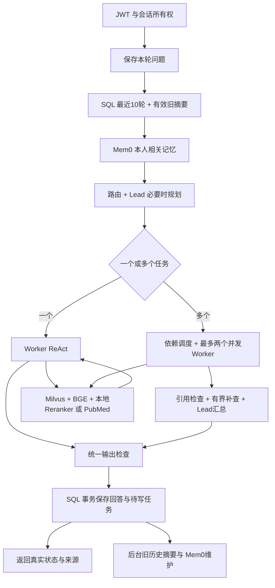

# 批次 D/E/F：知识库、真实 Provider 与记忆维护

日期：2026-10-13；独立 backend 主图版本 3。D/E/F 已实现并完成离线回归、真实 HTTP 验收和浏览器联调。测试使用合成账号、合成流程文档和公开 PubMed 索引，没有接入真实患者、公司数据或业务写入系统。

## 现在的完整链路



角色、模型、长期记忆、检索和摘要彼此分开。Mem0不是会话SQL或临床知识库；本地向量库不存JWT或密码；后台维护不改变已经保存的回答。

## D：本地知识库

- 使用 Milvus Lite **3.2.2** / PyMilvus **3.0.2**，已在 Windows / Python 3.12 运行。新版采用独立存储格式，本项目建立 backend/data/knowledge_v3.db，不迁移或打开旧参考数据库。配置指向两个参考目录时，程序在打开数据库前拒绝。
- 本地 Embedding：**BAAI/bge-small-zh-v1.5**，512维，FastEmbed / ONNX CPU；已下载到 backend/data/models。普通启动只允许读取缓存，不自动联网下载。
- Reranker：直接读取用户提供的 **D:/rag_project/models/reranker/bge-reranker-v2-m3**，CPU、local_files_only、trust_remote_code=false、Safetensors。没有下载或复制这份权重。
- 3份独立合成文档、3个片段；导入具有稳定片段ID，重复导入不增加条目，同一文档换版本清理本库的旧片段。集合重开时显式load，避免released状态无法查询；本地gRPC不经过HTTP代理，关闭空闲心跳，没有改全局代理。
- 分块到文本末尾就终止，校验size与overlap；检索分数为COSINE相似度，越高越相似。重排另给sigmoid分数，不将其当成临床可信度或概率。
- 来源保留文档ID、版本、字符位置、标题、URL、片段ID与分数；无命中返回空资料和no_match，工具异常有明确错误。
- 同一片段不同查询的检索/重排分数不会制造来源冲突。冲突比较原文及出处；只在文档别名对应唯一已观察片段时转成规范片段ID，歧义引用仍拒绝。

## E：真实 DeepSeek、Mem0、PubMed

- DeepSeek Flash显式非思考。Lead/汇总/摘要使用JSON结构校验；Worker采用原生工具调用，最终通过final_response提交结构化答案。final_response由适配器转成Decision，没有外部副作用，不算一次实际检索工具操作。模型仍按需选择只读工具。
- Worker只有一条系统消息；摘要、历史、记忆作为不具备授权效力的背景。最终引用提供实际可用ID列表，前置任务的已验证来源也可以被依赖Worker引用。
- JSON/工具参数/任务枚举/依赖/引用仍由程序验证。真实模式最多一次格式修正，计入原模型和Worker预算；修正失败继续返回失败，不以fake回答代替。
- Mem0固定V3 scoped search/get-all/add、V1 update/delete/event。user_id从JWT确认的SQL用户生成应用命名空间，不接受客户端任意指定身份。失联、鉴权/余额/额度、错误契约与空命中有不同状态。
- 写入采用infer=false：应用先筛选明确稳定信息，再原文写入，不把模型推测或未验证诊断交给Mem0自动提取。异步PENDING不等于完成，需要事件/本人范围结果核对。
- 网络工具使用PubMed官方E-utilities：每次工具最多一个查询、两次HTTP请求、最多3条索引元数据；标题/日期/链接不等于论文全文。无任意URL抓取或隐藏的模型搜索循环。
- provider_calls保存尝试、HTTP状态、安全错误、耗时和DeepSeek实际token，不保存凭据或完整请求/响应；GET /runs/{id}/providers仍受所有权保护。

默认.env开关继续为false，密钥文件保留。显式 `run.py --real` 在本次进程启用真实模型/记忆、本地知识库/重排和PubMed，不写回.env。该演示进程硬上限为DeepSeek40、Mem060、PubMed8次请求；单轮最多16次模型/5次工具，每个多任务Worker最多4次模型、2次工具、4次迭代，全轮90秒、节点25秒、HTTP15秒，输出最多768token。后台摘要另有持久任务尝试预算，并受同一进程云调用上限限制。

单轮模型/工具计数是执行尝试；实际HTTP和后台摘要请求以provider_calls为准。达到云上限有明确CLOUD_BUDGET_EXCEEDED，不自动充值、升级或扩大预算。

## F：摘要与长期记忆维护

- 新增session_summaries、memory_facts、memory_jobs、provider_calls及fake_memory_blobs。通过新增表保留旧SQL数据；原始消息不删除。旧版本暂停检查点不跨版本恢复，旧结束记录可读取。
- 第11轮完成后，首个退出10轮窗口的完整旧对话生成摘要。提交内容、covered_until_seq、版本与输入hash；增量输入为旧有效摘要和新退出窗口的原始消息。检查版本与原消息hash，拒绝过时提交。
- 摘要失败保留原消息和旧有效摘要，有状态/错误、可重试。输入/输出均有大小预算；超大批次明确失败，不声称已压缩。摘要是有损内容，当前合成验收不能证明所有领域信息的保真率。
- 长期记忆先按白名单保留回答语言、风格、明确职业背景、持续目标；不自动保存每个答案。否定偏好保留“避免”，不能当成正向偏好。纠正更新版本，撤回阻止旧内容再次加载，允许显式恢复。
- 回答与memory_jobs在同一本地事务保存；后台处理add/update/delete/summary。响应时若未完成，显示pending，云操作失败不丢回答。操作键与本地版本避免重复写入。
- add结果不明先本人范围查找operation_key，不盲目重新添加；已接受异步任务追踪event。处理中的旧版本add在核对后清理自己的ID，不能覆盖新版本。后台任务带租约、有限尝试和安全错误。
- 纠正/撤回使该用户旧摘要失效，后续按原消息重建；模型上下文过滤含过时偏好的消息，SQL原文保留。过滤也核对历史远端ID，即使旧检索缓存缺metadata也不能复活已删除条目。
- API支持本人记忆列表、纠正/撤回/恢复、摘要、维护任务与有界重试。语言/风格编辑要求对应字段的规范值；前端有版本、同步状态、维护结果和provider记录。JWT仅存在页面内存，重新登录可读取旧SQL会话。

## 验收证据

| 要求 | 当前证据 |
|---|---|
| 有界分块、稳定ID、幂等导入、版本替换、重开集合 | tests/test_knowledge.py；真实prepare_knowledge.py导入3份文档/3片段并检索命中 |
| 本地BGE与用户已有reranker | prepare_knowledge.py --rerank成功；真实API来源带reranker名称和重排分数 |
| 原生工具参数、工具结果续接、结构化最终答案 | tests/test_providers.py；真实知识库/网络HTTP场景完成 |
| 依赖、多Worker预算、前置来源可引用 | test_multitask与test_references；真实3任务/3角色汇总完成 |
| provider故障分类、不虚构降级成功 | MockTransport覆盖401/402/429/503、超时、契约和总预算；真实测试曾出现格式/引用失败，保留失败记录后修复 |
| 最近10轮、11轮边界、覆盖与版本 | tests/test_maintenance.py；真实第11轮摘要覆盖消息1–2，第12轮加载该摘要与10轮近期消息 |
| Mem0隔离、纠正、撤回、防复活和恢复 | 离线测试覆盖；真实两个用户隔离、英文纠正确实进入模型上下文，删除后本人范围云端记录为0 |
| 不明写入不重复、异步PENDING、维护失败不丢回答 | 离线维护故障/竞争/版本测试；真实维护任务9个全部done |
| 前端实际流程、重新登录与状态展示 | Vue3真实模型提交、来源与分数、后台写入同步和保存纠正；5项原登记流程测试、构建通过 |
| 原始代码和数据保留 | 153个参考基线文件：缺失0/哈希变化0；升级前159条SQL记录逐行一致；升级前已备份两个DB |
| 后端回归 | 109项全部通过；测试不读用户.env，不调用云API，Milvus测试使用临时独立库与fixture向量 |

### 真实完整 HTTP 场景

记录：tmp/full-flow-live-20261013-204108.json。15个场景全部completed：10轮简短真实对话；知识库+偏好；多任务+记忆+摘要；PubMed网络；纠正后的记忆；另一个用户无记忆。幂等重放和跨用户运行访问拒绝也通过。

本次成功验收34次DeepSeek、22次Mem0、4次PubMed；DeepSeek输入60,089、输出4,973、合计65,062token。Mem0包含15次scoped search、2次add、2次结果核对、1次update、2次delete。使用2条合成偏好，已清理。另执行1次本人范围云端核对，结果0条，见tmp/live-cleanup-verification.json。

早期4次完整测试尝试的失败数据单独保留，不能和成功率混合：分别出现Worker纯文本、重复片段查询分数冲突、引用格式等问题。包含失败尝试的HTTP测试累计DeepSeek65次、Mem045次、PubMed4次，已记录DeepSeek98,067token；上述额外清理核对、独立PubMed探针2次及浏览器验收另计。未查询账单或账户剩余额度，不沿用手册模型质量百分比。

浏览器验收另计DeepSeek3次（5,342token）、Mem06次：真实检索回答、重新登录恢复SQL会话、英文纠正本地/云端版本2同步；随后仅清理自己的合成条目，版本3同步撤回，本人范围云端记录0条。记录tmp/gui-def-verification.json；截图在demo-frontend/qa/def-real-provider.jpg及def-memory-correction.jpg，后者是清理前的纠正状态。浏览器错误/警告日志0条，最终前端5项测试和构建通过，pip check无依赖冲突。

本阶段已记录的上述真实调用合计：DeepSeek68次、Mem052次、PubMed6次，DeepSeek共103,409token。包括失败尝试、成功主链、额外清理核对、PubMed探针及GUI验收；不包含此前批次C的独立3/5次协议冒烟，不等于账单金额。

最终撤回状态截图：demo-frontend/qa/def-memory-cleanup.jpg。验收后已重启本次8010演示后端以提供新的进程调用预算；没有改变.env、SQL历史或本地模型，也没有为重启额外调用模型。

真实故障（如额度耗尽）没有故意在云端制造；相应故障路径是离线受控验证。真实观察证明本次合成端到端链路可用，不证明临床答案正确、整体检索质量或摘要长期保真率。

## 启动与复现

```powershell
Set-Location 'E:\medical agent\backend'
# 需要新下载Embedding时才加 --download-model；Reranker已在用户给出的路径。
.\.venv\Scripts\python.exe scripts\prepare_knowledge.py --rerank
# 离线：python run.py。以下显式使用真实provider，不改变.env。
.\.venv\Scripts\python.exe run.py --real
```

另一终端执行 `scripts/full_flow_live.py --run` 才进行真实验收；每次创建新合成账号，有调用费用/额度使用，不能当作普通全量回归。普通测试用 backend/test.ps1。scripts/smoke.py只针对默认离线服务，provider_smoke.py是独立单步协议测试。

前端：demo-frontend内 `npm run dev`，打开 http://127.0.0.1:5178/ 的“后端联调”。当前可看真实模式、请求、任务、摘要、来源与长期记忆维护。登记工作台依旧是本地合成登记演示，没有接入真实业务Service。

下一阶段G：固定评测集、单/多任务同口径质量与成本比较、按实际需求接入登记模拟Service/人工确认；企业OIDC/SSO、真实患者数据、部署与医学质量验收另行定义。
