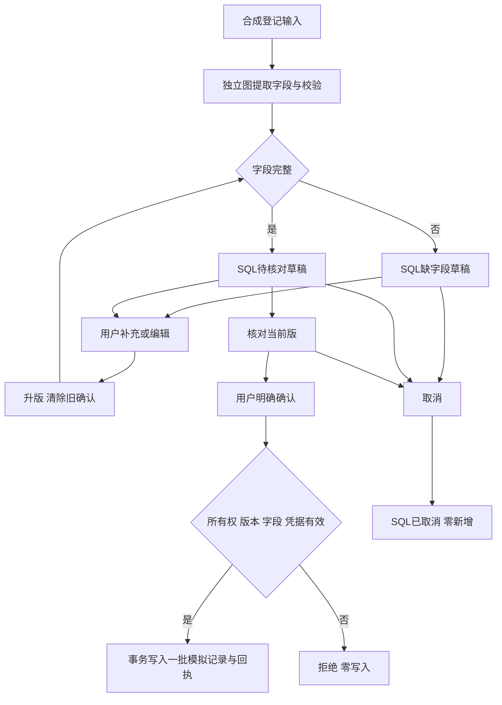

# 批次G：端到端演示与评测

日期：2026-10-13。批次G已完成；独立backend 0.7.0，查询主图v3，模拟登记registration_graph_v1。使用DEMO项目、合成问题、3份合成流程资料；不接真实业务Service，不使用患者或公司内部数据。原参考代码保留。

## 1. 当前可演示的两条链路

查询：JWT/会话 → SQL窗口与Mem0 → Lead必要时规划 → 单Worker或多任务DAG → ReAct只读工具 → 引用检查/汇总 → SQL结果与记忆维护。

登记：显式“生成服务端草稿” → registration_graph_v1有界字段提取/规则校验 → SQL保存缺字段或待核对草稿 → 用户编辑升版 → 核对当前版 → 明确确认 → Service身份/字段/版本/确认凭据校验 → 单事务写模拟记录、终态和幂等回执。取消进入终态且不新增登记。

登记待补充/待确认由SQL持久保存，不依赖查询Worker检查点或进程内确认状态。准备图只处理确定性提取/校验；实际业务确认采用Service事务。字段提取是有限规则，歧义保留空字段供用户补充，未加入通用LLM登记抽取或真实业务写入工具。登记操作不进入Mem0画像，咨询回答不能代替用户确认。

## 2. 登记Service与前端

- 新增registration_drafts、registration_records、registration_actions；保留原表和旧行。草稿绑定本人会话，记录绑定本人和唯一draft_id。
- 每项修改先取得SQLite短写事务，再读取版本；确认/编辑或确认/取消竞争只有一个有效结果。记录、草稿终态与操作回执同事务提交，回执保存失败时登记也回滚。
- request_id按用户唯一。同键同内容重放原回执；不同操作/内容返回409。相同草稿重复有效确认仅返回原记录，不新增批次。响应不明可GET状态或重放原请求，原回执快照并非最新草稿，最新状态以GET为准。
- 编辑每次升版，清除旧确认；review生成绑定当前版本的确认凭据，不能仅提交“确认”或伪造字段直接写入。明确确认必须为严格布尔true。已确认/取消草稿不能再次编辑，取消后确认被拒绝。
- 仅DEMO-A/B、组织/血液/唾液、DEMO-B/C区域，数量1–20整数、真实有效YYYY-MM-DD日期；备注最多300字。每用户最多200草稿/100批记录，超限显式拒绝。
- 所有接口校验JWT当前用户、会话和资源所有权；越权404，无权限零写入。审计返回动作、版本、请求标识和时间，不返回确认凭据。
- Vue3新增SQL草稿、字段编辑、版本核对、明确确认、取消、记录与审计。未保存编辑立即清除本地确认区；刷新不会自动确认。前端网络重试保留同操作标识，服务器负责幂等与版本校验。
- 左侧原演示明确标为“浏览器登记/浏览器记录”，其localStorage计数与本人SQL登记分别显示；浏览器重置不清除后端SQL。

## 3. 评测中发现并修复的问题

1. 旧测试按并发task_results下标判定目标任务，偶发取错结果。改为按task_id核对，没有调整业务调度顺序。
2. Worker即使没有剩余工具额度，或没有下一次模型/迭代空间，仍向模型展示检索工具。先用失败测试复现，再按持久剩余预算收敛工具列表；真实执行仍再次检查全局/Worker预算，模型不能借此扩大额度。
3. 真实多Agent的冗长输出会触发768token截断。收紧Worker/汇总答案长度，来源ID只放source_ids，不在正文重复；保持原请求/输出预算。截断仍明确失败，不吞错或自动fake兜底。
4. 实时演示的Milvus Lite库不能由另一进程打开。真实评测改用独立库导入同3份文档，复用本地BGE和用户已有reranker；不复制/下载reranker权重，不停止用户的其他应用。
5. 云模式预算失败文案原来仍包含“离线模拟”。现在显示预算受限与任务未完成，已取得资料不冒充完整回答。
6. 登记子面板请求遇到JWT过期时会卸载，局部错误提示随之消失。现在父面板明确提示重新登录，再从SQL读取会话和草稿，不把过期当作数据丢失。

## 4. 已验证结果

| 验收 | 结果与范围 |
|---|---|
| 后端回归 | 最终123 passed；包含11项登记测试与新增预算收敛测试；全程离线fake或临时fixture库，不读取.env |
| 前端 | 原登记逻辑5 passed；Vue/TypeScript及Vite构建通过；新增SQL面板另用真实浏览器和HTTP验收 |
| 同题离线拓扑 | 3题×单/多两种拓扑，6/6完成；fake不计算质量关键词评分，无云请求 |
| 最终真实配对 | 单Agent 3/3、多Agent 3/3完成；各3/3拓扑与来源契约通过；不是模型正确率 |
| 正常API Lead路由 | 单Agent 1任务，多Agent 3任务/3角色，均completed、有来源；幂等重放与跨用户404通过 |
| 登记HTTP链路 | 最终20项检查全部通过：缺字段、核对零写入、旧版本拒绝、越权拒绝、确认1批、重放1批、取消零新增、取消后确认拒绝、本人隔离与刷新 |
| 浏览器登记 | 缺字段→补齐第2版→核对→修改数量→第3版重新核对→确认4份血液1批；再取消第二份草稿，仍1批 |
| SQL事务与重启 | 受控回执失败回滚、并发双确认、确认/编辑及确认/取消竞争通过；重新创建app后待确认草稿可继续 |
| 原资料和旧数据 | 153参考基线文件缺失0/变化0；G升级前674条SQL行逐行一致；备份backend/data/backups/before-g-app.db |

浏览器截图：[取消后记录数不变](../demo-frontend/qa/g-registration-cancel.jpg)。该SQL合成账号审计显示prepare/edit/review/edit/review/confirm，已确认第3版和另一个cancelled草稿；后端重新启动、JWT过期后重新登录并选择原会话/草稿，页面仍显示已取消与本人1批SQL记录。API核对一致，无长期记忆条目。最终浏览器错误/警告0条。模拟登记不产生模型或Mem0请求。

## 5. 最终真实配对比较

数据集synthetic-workflows-v1，3题：登记规则、记忆边界、检索证据边界。两种拓扑使用相同题目、fresh会话、相同16次模型尝试/5次工具全轮上限、Worker4模型/2工具/4迭代、每请求768输出token，统一仅本地知识库工具。交替运行顺序；没有重复采样或统计显著性分析。

固定计划：single用research；multi用research检索，再由explain/review依赖其结果，Lead汇总。固定计划不调用模型，但主图计入一次规划预算尝试；因此“模型尝试”与实际HTTP分开报告。实际Lead路由由正常API另验证。Mem0/网络在该配对评测中均关闭，历史和用户记忆都是空的。

| 指标 | 单Agent（n=3） | 多Agent（n=3） |
|---|---:|---:|
| 完成 | 3/3 | 3/3 |
| 来源契约有效 | 3/3 | 3/3 |
| 实际DS HTTP | 6 | 16 |
| 模型预算尝试 | 9 | 19 |
| 工具尝试 | 4 | 5 |
| DS总token | 9,846 | 29,765 |
| 耗时P50秒 | 3.594 | 8.141 |
| 耗时P95秒（nearest-rank，3样本即最大值） | 5.204 | 9.796 |

每题4项关键词线索，两种拓扑最终各12/12出现；这只是字符串匹配，不验证否定、因果、完整覆盖、引用对结论的支持或医学正确性。human_review=not_run，clinical_quality=not_evaluated。当前多Agent消耗约3倍token、更多请求与耗时，不能从完成数或角色数得出质量更高的结论；简单、连贯问题优先单Agent，独立目标或依赖检查再用多Agent。

最终成功配对使用22次DS/39,611token；正常HTTP另用10次DS、2次Mem0范围检索、19,030 DS token。没有云记忆写入，不需要删除已有用户记忆。初期3轮真实配对未全部完成，单独保留；另一次HTTP多任务失败也保留，不和最终成功率合并。

包括失败尝试的G累计：DS92次、Mem04次、PubMed0次，DS194,193token。初次Milvus文件锁启动失败尚未发出云请求。没有查询账单/余额，也没有充值、升级或修改.env；每次真实评测都有独立36次DS硬上限，未自动执行付费全量回归。

## 6. 可复现证据与边界

归档在docs/evaluation：

- [最终真实配对](evaluation/g-eval-real-20261013-145110-d94202.json)
- [最终离线配对](evaluation/g-eval-offline-20261013-145538-18a34c.json)
- [最终真实HTTP](evaluation/g-http-20261013-145452-5af6c5.json)
- [GUI SQL核对](evaluation/g-gui.json)、[旧SQL保留](evaluation/g-preservation.json)、[G调用累计](evaluation/usage.json)
- 其余g-eval-real和g-http文件保存早期失败状态、任务错误与token，不能当作通过。

启动、演示步骤、恢复与评测命令见[端到端演示指南](端到端演示指南.md)。固定评测脚本不读取原参考数据库。真实Provider错误分类、摘要与维护的故障路径沿用D/E/F离线证据，不声称本轮故意制造云端额度耗尽。

未实施：临床数据与医学质量评测、人工语义评分、代表性大数据集/重复采样、企业OIDC/权限矩阵、真实登记接口、生产部署、通用自然语言业务意图抽取。这些不属于本次模拟G验收。业务字段需在真实接入前另定义；当前登记确认流程不能直接宣称满足正式医疗业务要求。
