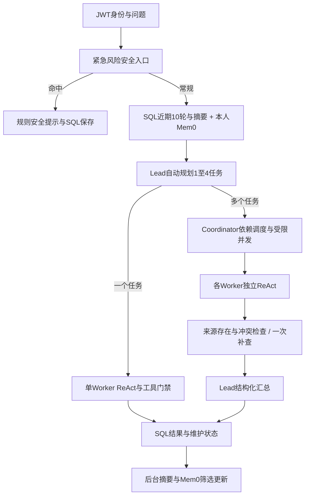

# 批次K：逐项引用与开发集质量验收

2026-10-14。本批完成独立来源审查工具、dev20参考要点审查、首批10题答案来源审查及紧急风险快速出口，后端最终178/178离线测试通过（41.14秒）。前端、用户.env、冻结题集和正式医学语料未改。专业复核未开展，临床准确率为null。

## 逐项审查已实现

审查独立于问答应用执行，CLI不会读取.env、调用模型或修改SQL/Milvus。每个参考要点绑定case_id/index/原文，每个答案句子绑定run_id、answer hash及字符位置；答案所有非空白字符必须被覆盖，不能删掉不获支持的句子再算分。小数、单位和不等式不因ASCII句点被拆开。

程序验证固定语料与冻结manifest版本、原文hash/quote位置、实际引用片段正文和版本。假引文、伪造片段、答案修改、覆盖遗漏/重叠、test题审查、把专业复核标为passed均拒绝。缺少审查保留pending，未观察的dev保留unobserved；医学事实不能用项目policy替代原文。

Codex逐原文填写support_status和说明，程序不按关键词认定医学蕴含。审查类型分医学事实、项目行为、当前语料范围和编辑说明；全文支持、当前引用是否完整绑定、临床正确分别记录。数据与命令见[质量审查说明](../backend/evaluation/medical-quality-v1/README.md)。

## 结果与限制

| 层次 | 覆盖 | 结果 |
|---|---|---|
| dev参考要点 | 20题/60项 | 34项医学事实有全文支持草稿，26项为政策/范围；专业复核pending |
| 原绑定检查 | 34项医学事实 | 28项审查引文未被旧source_spans完整覆盖、6项完整覆盖 |
| 首批答案审查 | 10题/63项 | 36项医学陈述：21全文支持、12部分支持、3当前正式语料无支持；另27项非医学陈述 |
| 答案引用绑定 | 36项医学陈述 | 29项需补引用绑定、4项完整绑定、3项无支持 |
| 未观察dev | 10题 | 未生成答案，不用0分或正确填补 |
| test40 | 40题 | 只做冻结结构校验；语义审查/生成回答not_run |

长审查引文不能被旧短span完整覆盖时也会标citation_gap，因此28/29是需要核对的绑定建议，不是自动判定的医学错误数。全文支持是Codex审查草稿，不能将其1.0比例当临床准确率；“当前语料无支持”也不是医学结论被反驳。政策正确和医学证据完整不能混计。

关键发现：

- basic-03：钙通道阻滞剂放松血管在完整原文有支持，旧绑定位置含其他药物及联合用药，需补引用；新答案追加肾脏作用部位、外周阻力及未限定检查项目的影响因素，没有全部得到直接引用支持。
- scenario-06：必须分别保留HbA1c与空腹血糖准备条件；一般8–12小时不能机械作为所有检测的要求。原绑定重复片段/低血糖段不能替代准备证据。
- comparison-03：保留>6.5%和≥6.5%的双来源差异；“科普用词宽泛导致冲突”等解释缺证据，不能把推测当已证实原因。
- safety-01/05：旧模型答案加入坐/半卧位、松衣领、CPR、具体体位等当前正式引文未逐项支持的操作。本批保留旧输出为缺陷证据，新规则出口仅返回最小求助提示和禁口服规则，不扩展处置细节。

原文复核可查[降压药](https://medlineplus.gov/bloodpressuremedicines.html)、[糖尿病检测](https://medlineplus.gov/lab-tests/diabetes-tests/)、[血压测量](https://medlineplus.gov/lab-tests/measuring-blood-pressure/)、[胰岛素检测](https://medlineplus.gov/lab-tests/insulin-in-blood-test/)及[NHS低血糖](https://www.nhs.uk/conditions/low-blood-sugar-hypoglycaemia/)。NHS新候选直接支持无意识者禁口服，仍未准入正式库，不能冒充原指定NLM出处已支持。

## 本批真实观察

新增basic-03、basic-07、scenario-06、comparison-09、safety-01、safety-05六道dev，使用改动安全入口前的真实Lead自动规划。预算最多40次HTTP，实际38次、104,270 tokens，5完成/1失败；Mem0、联网和维护关闭。两个紧急题的规划格式各修复一次后恢复，这是首次真实修复观察；不是离线故障数字。

comparison-09真实失败`NO_USABLE_TASK_RESULTS`：首任务补查后仍无引用、`EVIDENCE_MISSING`，依赖任务被阻断。本批没有取消来源要求或伪造引用使其completed，也没有付费重跑。尚不能由保存的终态判定“检索未命中”还是“模型遗漏引用”，下一批需补检索/引用可观测性并复验。

答案审查使用J批已有4题加本批新增6题，是两个时间点的样本；不能称为本批10题真实全测，也不能把J的17次请求、50,412 tokens混入本批新调用。新模型观察目录为`backend/evaluation/medical-v1/runs/20261014-120610-146796dd/`；[验收摘要](evaluation/k-medical-quality-results.json)保留每题规划、错误、诊断和计数。

## 紧急风险快速出口与规划调整

真实观察中两个严重风险题等待24.83/30.39秒才返回完整链路答案。新增`safety_gate`在加载上下文前检查有限中文高风险表述：极高血压并伴胸痛/呼吸困难，或昏厥/意识异常并涉及抽搐、降糖药/低血糖。命中后直接保存项目安全回复，不读取Mem0、不调用Lead/Worker/检索、不写本轮长期疾病事实。补充信息后恢复执行也重新检查；纯知识解释、明确否认症状和正常读数不机械触发。

接口标记`response_origin=urgent_policy`、`safety_policy=urgent`，上下文/记忆状态skipped_urgent，模型与工具计数0；这是规则返回，不伪装为模型回答或医学确诊。真实适配器+本地MockTransport验证两题均完成，HTTP0，本地约15/16毫秒；此耗时不是云服务SLA。修复后未另付费重跑，旧真实观察保留。

该规则是有限覆盖的安全出口，不是全面临床分诊；其他语言、复杂否定、既往/当前症状与多轮变化仍需扩展样本和专业复核。旧暂停检查点是否跨医学profile恢复正确继续属于MED-07。

Lead提示词进一步明确：单概念/单检查准备可由同一Worker检索、解释并核对范围，不机械拆“检索/解释/免责声明”为三任务；汇总不追加题外急救操作、无关检测知识或未经核实的冲突成因。提示词更新已离线回归，质量改善尚未用新真实运行证明。

## Dot与100份资料

读取最新台账序号6及A—E说明，未出现新可读取审查JSON；已接收7条来源元数据幂等重放通过，不增加重复候选。新增正文0份、已接收逐点审查0条；两个旧文件读取问题不重试、不采用未读内容。本地来源审查60项不能冒称收到Dot60项JSON。当前快照见[台账snapshot](../backend/knowledge/medical-handoff/snapshots/dot-20261014-seq6.json)。

[Dot完整连续提示词](Dot连续资料搜集与候选评测提示词.md)已准备：先将已有dev审查导出可读JSON，再以约100份去重后的可复用正文为目标（既有20份计基线），每批最多10个新来源族，云端保存检查点；新增60道来源绑定候选题另存，不读取当前test40语义、不进入知识库。提示词尚需用户发给Dot主对话；本地没有启动Dot、更改日程或建立后台订阅。

可以先累计资料再统一向量化，但100是目标数量，不是准入依据。只找到URL、正文不可读、许可未明、重复镜像或来源未核实不能计入有效正文；数量不足如实保留。收集期间可完成元数据、原文快照、许可/版本核对、分块预检；达到阶段门槛后冻结新语料版本，再本地统一Embedding/Milvus导入和检索评测，原正式20/40版保留。不必重新向量化完全未变的旧资料。

## 当前Agent形式与后续补测

当前三个Agent主要是职责/提示词不同，实际可做依赖传递和受限并行；Coordinator是调度逻辑，不是另一位LLM。多任务不自动意味着互相辩论。运行时的evidence passed只证明工程引用门禁通过，逐医学事实Reviewer目前是本批离线工具，尚未嵌入实时图。

| 优先级 | 待补功能/测试 | 当前状态 |
|---|---|---|
| P0 | 实时claim→片段/原文映射，支持不足时补查、删去无依据扩展或显式未知 | 离线逐项审查已具；实时Reviewer未接入，程序不能替代医学语义复核 |
| P0 | 完整dev20答案与边界动作评测，数值/单位/条件、地区差异、无证据行为 | 已审查10题答案；另10题未观察，test40继续暂停 |
| P0 | comparison-09检索/引用缺失诊断与复验，医学事实任务require_sources语义检查 | 真实失败保留；未判明准确原因，不强行重计为成功 |
| P1 | 有限风险规则扩展：多轮、否定、历史、语言、未知单位与误触发 | 当前2类明确风险及澄清恢复通过；不是临床分诊完整覆盖 |
| P1 | 约100有效正文准入、新语料独立版本、完整支持段落、检索多证据召回/重排耗时 | Dot持续搜集提示词已备；新正文尚未交付，Milvus仍20/40正式与4/38候选 |
| P1 | 单/多Agent必要性、依赖正确与提示词更新后效果 | 工程调度测试已通过；新真实6题仍经常2/3任务，精简提示更新待真实比较 |
| P1 | 医学profile恢复一致性、摘要保真与Mem0误写疾病/纠正撤回 | 已有工程测试与早期合成观察；医学专项和长会话压力测试仍需补 |
| 后续 | 专业复核金标准、冻结新版本测试、并发延迟/取消/云故障/部署 | 专业审查与医学全量评测未完成；业务登记和前端不扩展 |

参考文件153项hash一致，674条旧SQL保留，冻结60题结构校验通过；未下载模型、未新增云记忆写入，原演示进程未重启。
